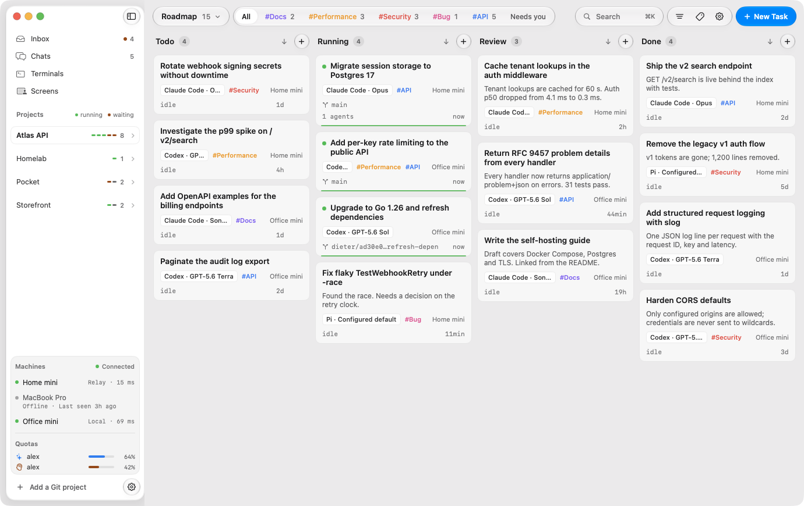

<p align="center">
  <picture>
    <source media="(prefers-color-scheme: dark)" srcset="assets/brand/assets/svg/logo-horizontal-light.svg">
    
  </picture>
</p>

<h1 align="center">Close your laptop.<br>Keep your agents running.</h1>

<p align="center">
  Run coding agents on your own always-on Macs and Linux hosts.<br>
  Follow the work from native Mac, iPhone, iPad and Android apps.<br>
  Open source. Self-hostable.
</p>

<p align="center">
  <a href="https://github.com/dbpprt/dieter/actions/workflows/ci.yml"></a>
  <a href="https://github.com/dbpprt/dieter/releases/latest"></a>
  <a href="LICENSE"></a>
</p>

<p align="center">
  <a href="https://getdieter.com/">Website</a> ·
  <a href="https://getdieter.com/docs/">Documentation</a> ·
  <a href="https://getdieter.com/docs/tour/">Product tour</a> ·
  <a href="https://github.com/dbpprt/dieter/releases/latest">Downloads</a>
</p>



Dieter is a workspace for coding agents (Codex, Claude Code, Pi, Oh My Pi and
DeepSeek Harness) that run on your own machines. A small daemon starts each
agent beside your Git checkout, with your tools and your provider accounts, and
keeps it running when you close the app or put your laptop to sleep. Native apps
bring every machine's boards, conversations, files, terminals and screens into
one place, so you can start a task on your Mac, let a Linux workstation do it,
and review the result from your phone.

- **Durable tasks.** Boards, standalone chats, labels and schedules; every task
  keeps one conversation you can continue at any time.
- **Many machines, one project.** Check out the same project on several hosts;
  each conversation runs on the machine you choose.
- **Review in place.** Files, Git changes, terminals, background processes and
  an authenticated remote screen, next to the conversation.
- **Your infrastructure.** The relay gateway is self-hostable and never stores
  code, transcripts or provider credentials.
- **Automatable.** The `dieter` CLI does everything the apps do, locally or on
  any enrolled machine.

Dieter is pre-1.0 and moves quickly. The daemon, gateway and apps ship as one
version, and the gateway rejects clients and daemons that are too old, so
update all of them together. Breaking changes are listed in the
[changelog](CHANGELOG.md).

## Install

| Platform                  | Install                                                                                                                                                                |
| ------------------------- | ---------------------------------------------------------------------------------------------------------------------------------------------------------------------- |
| macOS 26+ (Apple Silicon) | `brew install dbpprt/tap/dieter` (daemon and CLI), `brew install --cask dbpprt/tap/dieter-app` (app)                                                                   |
| Linux amd64/arm64         | `curl -fsSL https://github.com/dbpprt/dieter/releases/latest/download/install.sh \| sh` (needs [cosign](https://docs.sigstore.dev/cosign/system_config/installation/)) |
| Android 8+                | [Dieter-Android.apk](https://github.com/dbpprt/dieter/releases/latest/download/Dieter-Android.apk)                                                                     |
| iPhone and iPad (iOS 18+) | TestFlight beta; see [installation](https://getdieter.com/docs/installation/#iphone-and-ipad-beta)                                                                     |
| From source               | `just setup && just build`; see [docs/building.md](docs/building.md)                                                                                                   |

Daemon hosts need Node.js 22.19+, npm and Git, and a configured agent account.
Release checksums are signed; see [verifying releases](https://getdieter.com/docs/security/#verifying-releases).

## Quick start

Run a daemon on its own, without an account, and drive it from the CLI:

```sh
dieter serve &                                        # local daemon on 127.0.0.1:4242
project=$(dieter project open ~/src/my-project --format id)
chat=$(dieter chat create --project "$project" --auto-title --workspace worktree \
  --lane running --prompt "Explain the test setup" --format id)
dieter chat watch "$chat"
```

To reach your machines from the apps, enroll each host with a gateway instead.
`dieter setup` signs in with GitHub, enrolls the machine and installs the
background service. It defaults to `https://gateway.getdieter.com`, which admits
only allowlisted accounts; pass `--gateway https://YOUR-GATEWAY` for
[your own gateway](https://getdieter.com/docs/gateway/).

```sh
dieter setup
dieter project open ~/src/my-project
open -a Dieter                                        # sign in to the same gateway
```

The [quick start guide](https://getdieter.com/docs/quickstart/) walks through
the first task in the apps.

## How it works

A Go daemon runs agents next to your checkouts and replicates shared project
metadata with your other daemons; a Go gateway authenticates accounts and
machines and relays traffic when no direct route exists; the native apps share
one Kotlin core, with a Compose UI on Android and iOS and SwiftUI on macOS.
Agents run unsandboxed with your user's permissions. Read the
[architecture](docs/architecture.md) and the
[security model](https://getdieter.com/docs/security/).

## Documentation

- [User guides](https://getdieter.com/docs/): installation, projects and tasks,
  machines, screens, vault, CLI, self-hosting, troubleshooting
- [CLI reference](https://getdieter.com/docs/cli-reference/) and
  [environment variables](https://getdieter.com/docs/environment/)
- [Contributor docs](docs/README.md): architecture, invariants, threat model,
  building, testing, releasing

## Contributing

Contributions are welcome. Read [CONTRIBUTING.md](CONTRIBUTING.md) (commits need
a DCO sign-off) and the [code of conduct](CODE_OF_CONDUCT.md). Report security
issues privately as described in [SECURITY.md](SECURITY.md).

## License

Dieter is [MIT-licensed](LICENSE). The name and logo are trademarks; see
[TRADEMARKS.md](TRADEMARKS.md). Third-party components are listed in
[THIRD_PARTY_NOTICES.md](THIRD_PARTY_NOTICES.md). Pronounced **DEE-ter**.
