# Proposal: Liquid glass navigation and a separated composer for Android

Status: implemented 2026-11-16 (spiked 2026-11-15 on card `c_7b0e10554915`;
the owner approved it as built, with Lens + Card as the defaults) · scope: the Android touch shell in the
shared Compose UI (`apps/kotlin/ui`): the tab navigation, the creation button
and the conversation composer, on phones and foldables in both orientations.
iOS keeps its native UIKit bars; the Mac and the Android desktop shell are
unchanged.

Every variant is built and switchable on a device: **Settings → Appearance →
Navigation** (Classic · Dock · Lens · Island) and **Chat input** (Classic ·
Card · Glass). Most screenshots come from the offscreen UI test
`FloatingNavigationUiTest`. Skia runs the same lens shader as Android 13+, so
they show the real effect. §8 has the captures from an Android 15 emulator
at Fold and phone sizes.

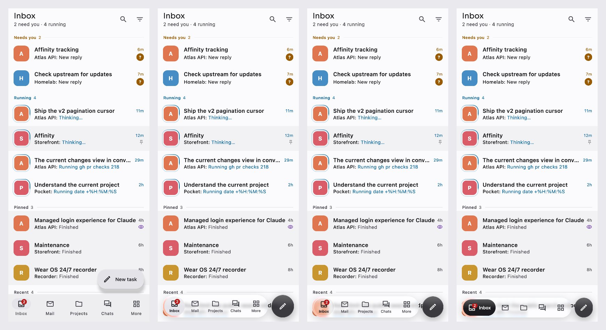

## TL;DR

The three screenshots from the Galaxy Z Fold7 show four problems:

1. **The bottom bar spans both panes** when the Fold is open. Its five tabs
   are 180 dp apart, and it sits under the conversation, where it doesn't
   belong.
2. **The composer stacks on top of the bar.** That leaves two horizontal
   bands at the bottom of the conversation pane, about 200 dp of chrome, and
   neither one belongs to the other.
3. **The composer looks washed out.** It uses three nearly identical tones:
   the band is `surfaceContainer`, the field `surfaceContainerHighest` and the
   chips `surfaceContainerHigh`, 5–10 % apart. There's no edge, shadow or
   outline, so you can't tell where the input starts.
4. **The New task button overlaps the list**, right above the bar. In
   landscape the docked bar also costs 80 dp of height that the content
   needs.

This change replaces the docked bar with a **floating liquid glass bar**.
The page scrolls underneath it, bent and blurred at the rim. The **creation
command becomes a tinted glass orb** next to the bar instead of a FAB on top
of the content. On an open foldable the bar floats **under the list pane
only**, and the conversation's composer reaches the bottom beside it, so both
sit on one baseline. In landscape the bar stands as a **vertical glass rail
on the leading edge**. The composer becomes a **floating card** with its
controls inside. A lit surface, an outline and a soft shadow separate it from
the transcript, which fades out beneath it.

**Recommendation:** ship **Lens** as the navigation and **Card** as the chat
input, with Dock and Island kept behind the setting for a release, then
removed (§9).

## 1. Design principles

- **Float, don't dock.** Chrome is an object above the page, not a band
  across it. Pages run to the bottom edge and pad their last rows by the
  bar's height, so nothing is hidden for good.
- **One material.** The bar, the orb, the lens and the glass composer use one
  glass recipe (§2) in four strengths. There's no fifth surface tone.
- **Separate with light, not tone.** The old composer used a tone that was
  5 % darker. The new surfaces get an edge: a lit rim, a hairline outline and
  a soft shadow. Each still reads in Monochrome, the default palette and the
  one on the Fold.
- **Respect the panes.** The navigation belongs to the list, the composer to
  the conversation. On an open foldable each stays inside its pane.
- **Motion carries meaning.** The selection is a drop of liquid that
  stretches toward the tab you picked and settles with a wobble. A drag lifts
  it into a lens. The bar gets out of the way while you read.

## 2. The glass material

`design/Glass.kt` (shared) and `platform/GlassEffects*.kt` (per platform).

| Layer (bottom → top) | How                                                                                                                                                                                                                                                                                                                                                                                                                            |
| -------------------- | ------------------------------------------------------------------------------------------------------------------------------------------------------------------------------------------------------------------------------------------------------------------------------------------------------------------------------------------------------------------------------------------------------------------------------ |
| Shadow               | `Modifier.dropShadow` (Compose 1.12): radius 22 dp, offset y = radius/3, 16 % black in light, 50 % in dark.                                                                                                                                                                                                                                                                                                                    |
| Backdrop             | The page is recorded once per frame into a `GraphicsLayer` (`Modifier.glassSource`). Each surface draws its own region of that recording, plus a margin, into a second layer with a `RenderEffect`: blur (9 dp), then the **lens shader**.                                                                                                                                                                                     |
| Lens                 | One AGSL/SkSL program (`GLASS_LENS_SHADER`). A rounded-rectangle SDF finds the rim. Inside an 18 dp bezel, the backdrop is sampled toward the centre along the edge normal, on a circular profile (`1 − √(1 − e²)`), so the rim magnifies and bends what passes under it. Red and blue sample slightly apart (dispersion), saturation lifts the colours, and an optional `zoom` magnifies the whole surface (the lifted lens). |
| Tint                 | White at 50 % (light) or `surfaceContainer` at 52 % (dark), so labels stay readable over any content.                                                                                                                                                                                                                                                                                                                          |
| Sheen and rim        | A soft vertical sheen on the upper half. A 1 dp inner rim with a diagonal gradient, brightest at the top left and faintly lit at the bottom right.                                                                                                                                                                                                                                                                             |

**Platform tiers** (`createGlassEffects()`):

| Platform                    | Effect                                                                                   |
| --------------------------- | ---------------------------------------------------------------------------------------- |
| Android 13+ (Fold7 runs 16) | Blur + AGSL lens (refraction, dispersion, saturation, zoom)                              |
| Android 12                  | Blur + saturation matrix (`RenderEffect.createColorFilterEffect`), no refraction         |
| Android 8–11                | No layer filters: the style's `fallback`, an almost opaque tint with the same rim/shadow |
| JVM UI tests                | Skia `ImageFilter.makeRuntimeShader`: the same shader as Android 13+                     |
| iOS                         | Blur only; the iOS app keeps native UIKit Liquid Glass bars                              |

**Strengths** (`GlassStyles`):

| Style    | Use                     | Tint                   | Blur | Refraction   |
| -------- | ----------------------- | ---------------------- | ---- | ------------ |
| `chrome` | navigation bar and rail | 50 % white / 52 % dark | 9 dp | 11 dp        |
| `panel`  | glass composer          | 76 % white / 78 % dark | 16   | 9            |
| `tinted` | compose orb, Start chip | accent at 86 %         | 9    | 11           |
| `bead`   | lifted selection lens   | 10 % white, no blur    | 0    | 7, zoom ×1.3 |

**Two rules the implementation depends on**, both learned the hard way in
this spike:

- **A surface must never sit inside its own backdrop's source.** The shell
  records the page and floats the bar above it. A conversation records its
  transcript and floats the composer above it. The bar records its tabs for
  the lens.
- **Source and surface each get their own `graphicsLayer`.** Without one, a
  surface that redraws because its backdrop changed invalidates its nearest
  parent layer. That layer can be the source, which then records again,
  bumps the backdrop's version and redraws the surface: an endless redraw.
  The first test run hung on exactly this (Lens + Glass composer on the
  Fold).

## 3. Navigation variants

All three floating variants keep the five tabs (Inbox, Mail, Projects, Chats,
More), the badges, the `nav-*` test tags and the More sheet. They differ in
shape and motion.

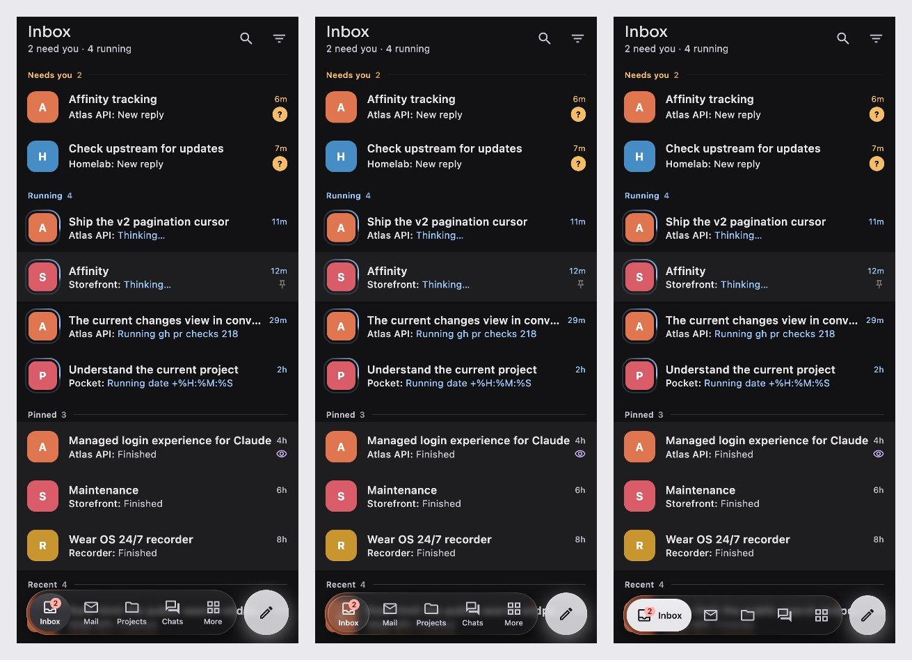

### Dock

A full-width glass capsule (66 dp) with icon and label on every tab, and the
orb beside it. The selection is an `accentContainer` drop. Its two edges
chase the selected tab on different springs: the leading edge is stiff
(520), the trailing edge soft (150). The drop stretches like a liquid and
settles with a wobble. Dragging along the bar lifts the selection into the
lens (see Lens).

- **For:** closest to the current Material bar, so nothing has to be
  relearned. Labels make it the most legible option.
- **Against:** the heaviest of the three. On a narrow list pane it has to
  drop its labels.

### Lens (recommended)

A slightly slimmer capsule (62 dp). The selection is a **clear drop**: a faint
body with a bright rim instead of a coloured pill, and the selected tab takes
the accent colour. **Press and drag along the bar**, and the drop lifts into a
glass bead that is real glass over the tabs. It records them and magnifies
them by 1.3×, with a domed rim and a chromatic edge. It snaps to the nearest
tab when you let go, and haptic ticks mark each tab you cross. **Scrolling a
page down shrinks the bar** to the current tab. Scrolling up, tapping it or
1.8 s without scrolling brings it back, so the other tabs are never gone for
long.

- **For:** the most "liquid" of the three, and it gives the page the most
  room while you read. The drag gesture is quick to learn for one-handed use
  on the tall cover screen.
- **Against:** the shrinking bar hides the other tabs until you scroll up or
  tap it. The clear drop is subtler than a filled pill.

### Island

A compact pill that wraps its content (58 dp): icons only. The selected tab
grows into an accent-filled pill with its label (`animateContentSize`). The
orb sits beside it.

- **For:** the smallest footprint; it leaves the corners of the screen free.
  The filled selection is the boldest of the three.
- **Against:** you have to learn four of the five tabs by their icons. No
  drag lens: the pill changes width as you go, so a drag would chase a moving
  target.

### Motion

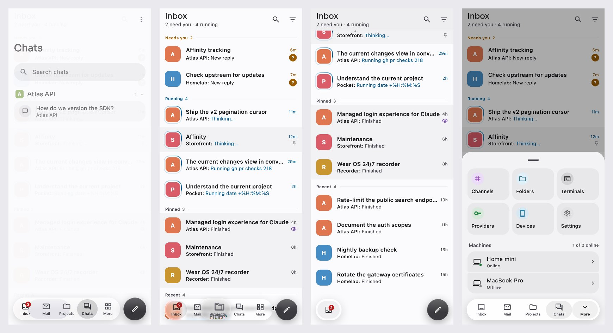

The first frame is 90 ms after tapping Chats: the drop stretches from Inbox
toward Chats. The second shows the lifted bead magnifying Projects, with its
refracted label at the rim. The third shows the bar shrunk while the page
scrolls. The last shows the More sheet, which keeps the floating bar at its
foot (the sheet is its own window, so the bar uses its fallback tint there).

### Palette

Colour palettes tint the drop and the orb. Here is Electric Blue in light and
dark:

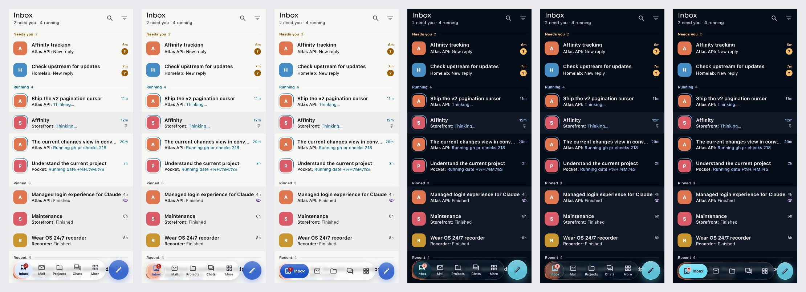

## 4. Placement

`MaterialShell` (`app/MobileApp.kt`) decides where the bar goes from the
window shape:

| Window                                                         | Classic (before)                | Floating (Dock, Lens, Island)                                                                                  |
| -------------------------------------------------------------- | ------------------------------- | -------------------------------------------------------------------------------------------------------------- |
| Phone portrait (< 600 dp)                                      | Docked bar                      | Bottom, centred, at most 560 dp wide                                                                           |
| Fold inner, portrait (≈ 750 × 832 dp, two panes)               | Docked bar under **both** panes | Bottom of the **list pane** only; icons only below 390 dp (`dense`). The composer reaches the bottom beside it |
| Fold inner, landscape (≈ 832 × 750 dp), any landscape two-pane | Docked bar (< 840 dp wide)      | **Vertical rail** on the leading edge, vertically centred, orb on top; the page keeps a gutter                 |
| Short windows (< 480 dp tall: phone or cover screen sideways)  | Material rail (≥ 840 dp wide)   | Compact vertical rail, icons only                                                                              |
| An open conversation on a phone (immersive)                    | Bar hidden                      | Bar hidden (slides away)                                                                                       |

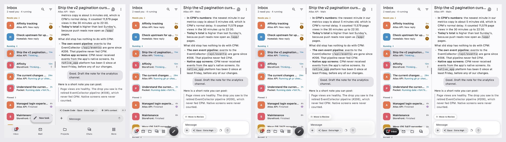

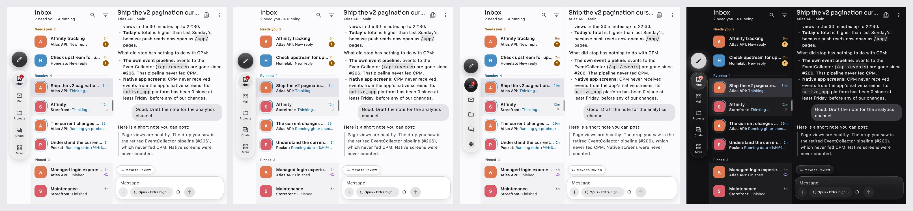

Two details make this work:

- **Insets per pane.** `TabStack` gives the list pane and the detail pane
  their own `LocalScreenInsets`. Only the pane beneath the bar pads its
  bottom by the bar's height (`NavigationStyle.floatingReserve`). The
  conversation beside it pads only for the system bars.
- **The list width follows the split.** `ListDetailSplit` reports the list
  pane's live width (`onListWidth`), so the bar follows the divider, and
  goes full width when either pane collapses.

**Side rail gutter.** Page bodies only read top and bottom padding from
`ScreenScope`, so a rail floating over the list covered its avatars (first
test run, landscape). The leading pane now moves right by the rail's width
instead. The rail floats over the gutter, not over rows.

**The creation command.** Screens still publish `ScreenChrome.primary`. Under a
floating bar, `MaterialScreen` hands it to a `PrimarySlot` instead of drawing
a FAB, and the bar shows the most recently published live command as the orb
(test tag `chrome-new-task`, as before). A screen without a command, such as
Mail or More, hides the orb with a scale-out animation.

## 5. Composer variants

`conversation/Composer.kt` (`FloatingComposer`) and
`conversation/ConversationScreen.kt`.

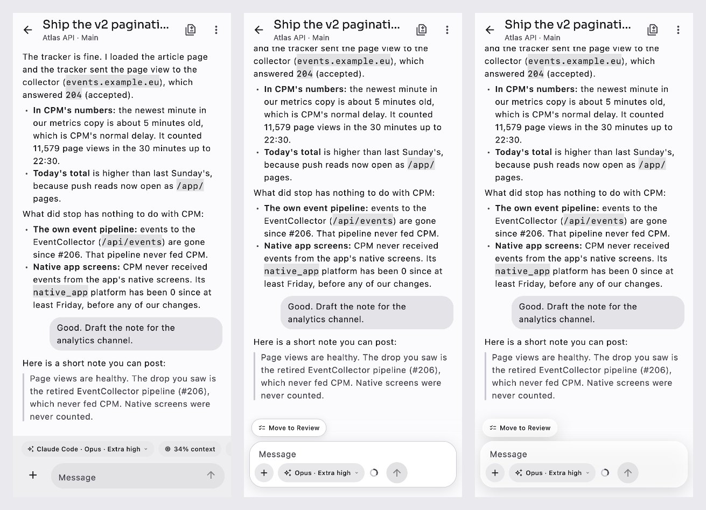

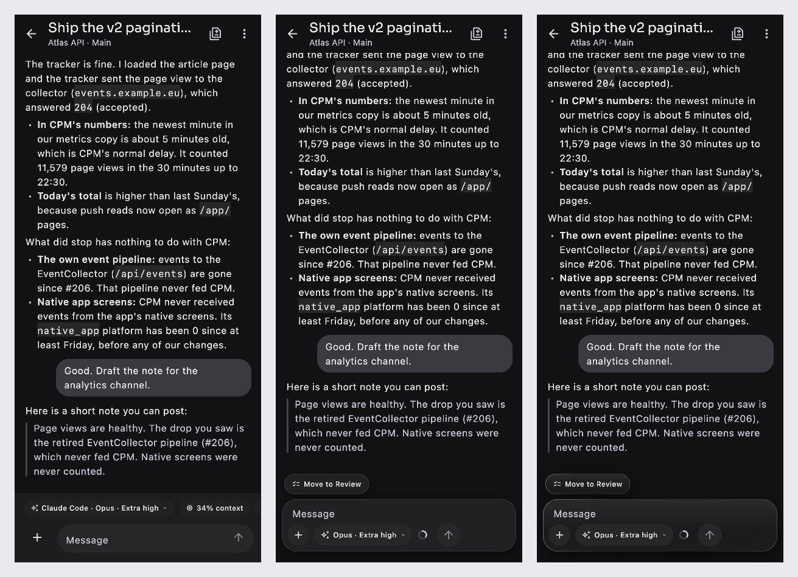

The Card and Glass composers share one layout:

- **A floating card**, 10 dp from the edges, with 26 dp corners. The
  transcript scrolls on beneath it. A gradient scrim fades the transcript
  out under the card: strong for Card, light for Glass, so the glass still
  has something to bend. The list's bottom padding follows the card's
  measured height.
- **Inside the card**, the message field takes the full width, up to 8 lines.
  The controls sit along its bottom edge: **attach**, the **agent chip**
  ("Claude Code · Opus · Extra high", or "Opus · Extra high" when the card is
  narrower than 420 dp), the **context gauge** (a ring, plus the number when
  there's room) and **send/stop**.
- **Commands about the conversation float above the card** as chips: Start
  (accent glass), Move to Review and waiting tools. They are actions, not
  settings, so they no longer sit in the same row as the agent picker.
- **Separation:** Card uses `surfaceContainerLowest` (white) in light and
  `surfaceContainerHigh` in dark, with a 1 dp outline and a 20 dp shadow.
  Glass uses `GlassStyles.panel()` (76 % tint, 16 dp blur). **Focus turns the
  outline accent-coloured** at 1.5 dp, so you can see where you're typing.
- Test tags are unchanged (`message-input`, `send-message`, `stop-agent`,
  `attach`, `agent-chip`, `move-review`, and `composer-chips` on the command
  row), so `task.yaml` and `queue.yaml` keep working. `composer-card` is new.

**Card vs Glass.** Card is the safer default: it is legible over any
transcript, at any palette and in direct sunlight, and it costs nothing on
older devices. Glass matches the bar and looks striking over code blocks and
images, but its 76 % tint is a compromise. Lower, and dense text behind it
starts to compete with what you type.

## 6. Implementation map

| File                                                     | Change                                                                                                                                                   |
| -------------------------------------------------------- | -------------------------------------------------------------------------------------------------------------------------------------------------------- |
| `ui/…/design/Glass.kt` (new)                             | `GlassBackdrop`, `glassSource`, `glass(…)`, `GlassStyle`, `GlassStyles`                                                                                  |
| `ui/…/platform/GlassEffects.kt` (+ android, jvm, ios)    | `GlassLens`, `GlassEffects`, `createGlassEffects()`, `GLASS_LENS_SHADER`                                                                                 |
| `ui/…/app/FloatingNavigation.kt` (new)                   | `FloatingNavigation`, the bar, the drop and lens, the orb, `PrimarySlot`, `floatingReserve`; `TabIcon` and `rememberTabBadges` moved here                |
| `ui/…/app/MobileApp.kt`                                  | Placement, per-pane insets, gutter, minimize-on-scroll, snackbar offset, More sheet bar                                                                  |
| `ui/…/app/PaneSplit.kt`                                  | `onListWidth`                                                                                                                                            |
| `ui/…/app/Chrome.kt`                                     | `MaterialScreen` publishes its primary to the slot instead of drawing a FAB                                                                              |
| `ui/…/app/More.kt`                                       | `MoreSheet(floatingBar = …)`                                                                                                                             |
| `ui/…/conversation/Composer.kt`, `ConversationScreen.kt` | `FloatingComposer` (Card and Glass), the floating dock with scrim and measured padding                                                                   |
| `ui/…/store/LayoutModel.kt`                              | `NavigationStyle`, `ComposerStyle`, preferences `navigation-style` and `composer-style`. The defaults are Lens + Card                                    |
| `ui/…/store/DebugScript.kt`                              | Script verbs `nav dock\|lens\|island\|classic` and `composer classic\|card\|glass`                                                                       |
| `ui/…/settings/SettingsScreen.kt`                        | Navigation and Chat input pickers (Android only)                                                                                                         |
| `ui/src/jvmTest/…/app/FloatingNavigationUiTest.kt` (new) | Nine UI tests: tabs and orb per style, selection and stretch, lens drag, minimize, More sheet, fold portrait beside-composer, landscape rails, composers |

## 7. Verification

- Full `:ui:jvmTest`: 94 of 94 pass. That includes the 9 new
  `FloatingNavigationUiTest` tests, `InboxScreenUiTest`, and
  `MaterialChromeUiTest`, which now pins Classic because it tests the
  Material rail's toolbar.
- `:ui:compileKotlinIosSimulatorArm64` compiles (shared code and the iOS
  `GlassEffects` actual).
- `:android:lintDebug :android:testDebugUnitTest`, the tasks of the
  `android test_unit` lane, pass.
- `gradlew test` passes, except `:core:e2e`, which needs the harness runtime
  installed in the worktree and doesn't touch this change.
- `just fmt-check` and `just site-check` pass.
- **Not run in this spike:**
  - the Maestro device flows (`android e2e`, `ios e2e`);
  - `ios build`;
  - the Mac lanes. They link `:core:apple`, not `:ui`, so they can't exercise
    this change.
- The new tests cover:
  - five tabs, the orb and no duplicate FAB for every style in light and dark;
  - the tab's own command on the orb (Chats → `chrome-new-chat`);
  - the stretching drop, captured mid-flight;
  - a lens drag that selects the tab beneath it;
  - minimize on scroll, and tap to expand;
  - the More sheet's floating bar;
  - on the open Fold, the bar beside the composer, never under it;
  - vertical bars in landscape;
  - all three composer styles, with the bar hidden in an open phone
    conversation.
- An E2E build (`:android:assembleE2e`) ran on the API 35 emulator against
  the inbox and showcase fixture gateway. It was captured at Fold inner size
  in portrait (`wm size 1500x1650`, density 320) and landscape (`1650x1500`),
  and at phone size (`1080x2400`, density 420), always under the device lease.

## 8. On-device results (Android 15 emulator, real `RenderEffect` + AGSL)

**Before and after on the open Fold.** Classic reproduces the screenshot from
the Fold: one bar across both panes, with the composer stacked on top of it.
With Lens + Card, the glass pill sits under the list, the orb replaces the
FAB, and the composer card reaches the bottom of the conversation pane on
the same baseline:

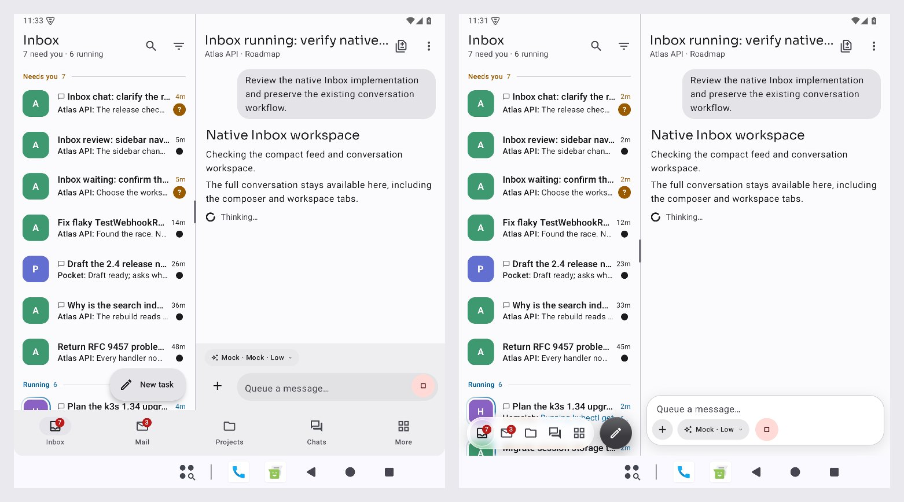

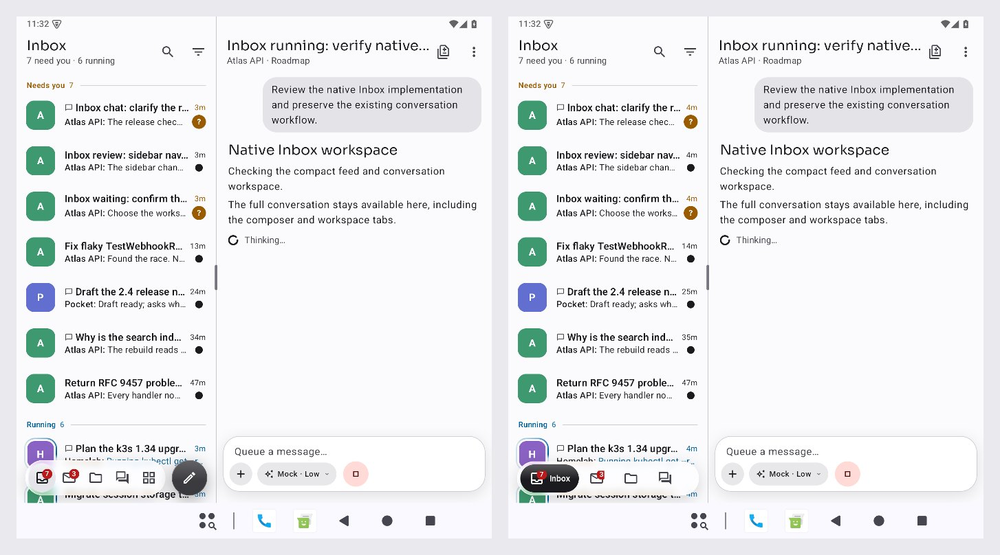

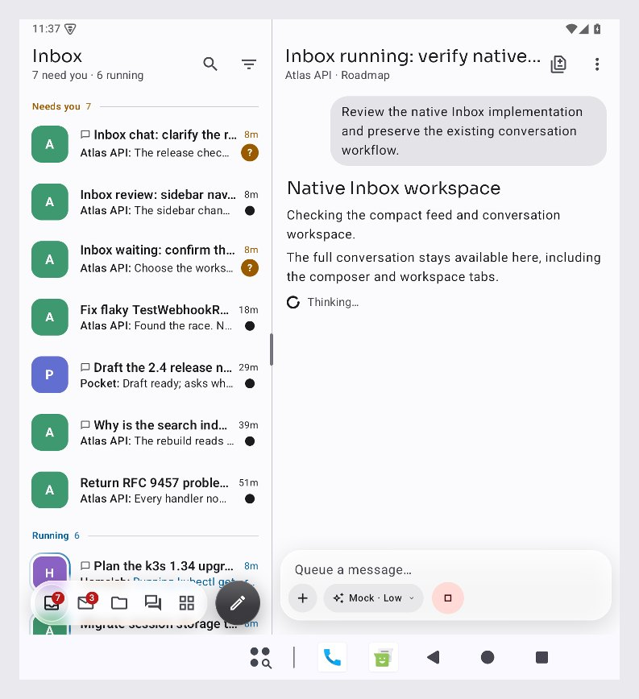

**Landscape.** The vertical rail stands in its gutter, with the composer
card beside it. Shown in light, and in dark with Island and the Glass
composer:

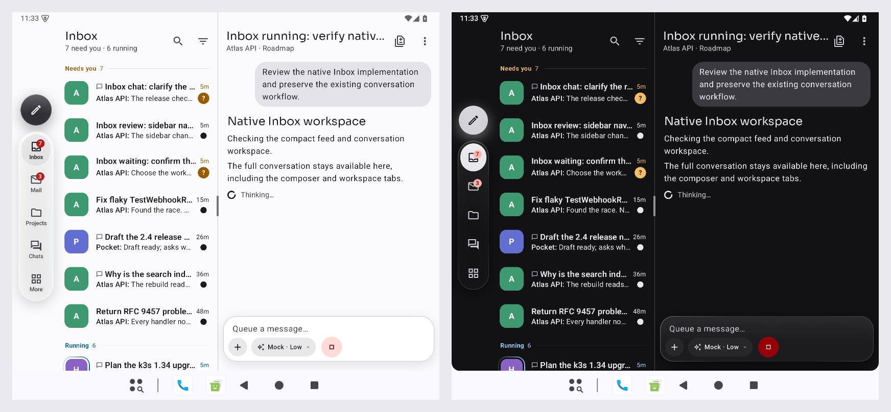

**Phone** (3-button navigation): Lens, Island, Dock dark, and the Card
composer:

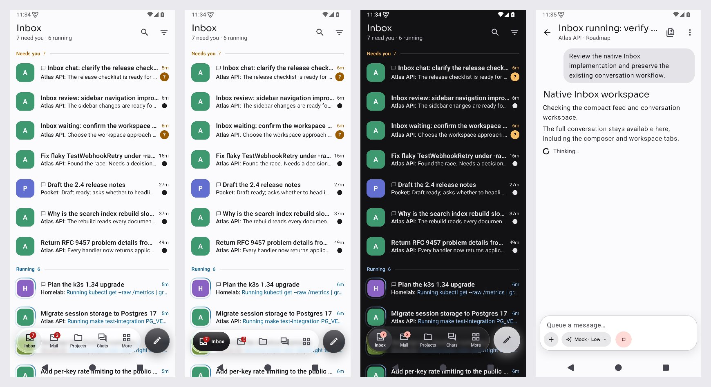

**Scrolling.** After a swipe, the glass shows the new rows beneath it, so the
recorded backdrop follows the page on Android (first pair, Dock on the Fold).
Lens shrinks to the current tab while the page scrolls down (second pair):

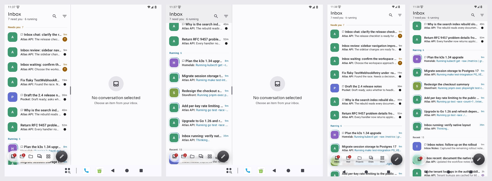

What the emulator can't tell us, so it still has to be checked on the Fold7:
frame times while scrolling under the glass, the haptics on the lens drag,
and how the rim reads in sunlight.

More offscreen renders: dark Fold portrait and the compact rail on a phone
held sideways.

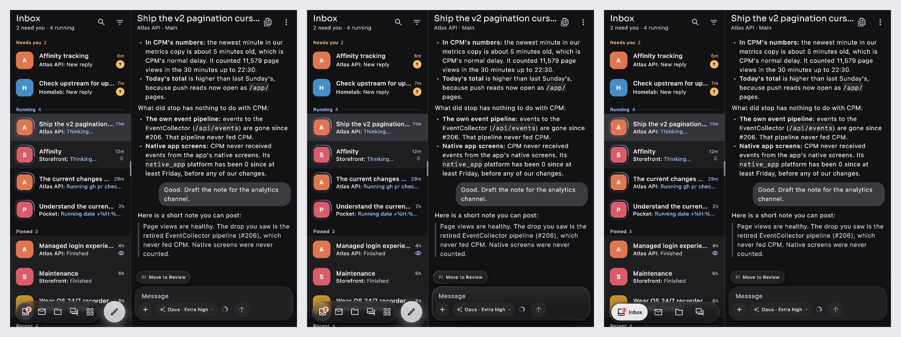

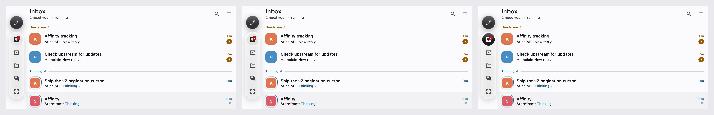

## 9. Decision and follow-ups

The owner reviewed the screenshots and approved the spike as built.

- **Defaults:** Lens navigation and the Card composer for every Android
  phone and foldable.
- **The other variants stay selectable** in Settings → Appearance for now:
  Dock, Island and Classic navigation, and the Glass and Classic composers.
  Once the defaults have run on real devices, remove the ones nobody uses in
  one change (clean break, no migration).
- **Device flows:** `task.yaml` swipes the command row only while it is
  shown, because the floating composer shows that row only when it holds a
  command. Tabs drawn as icons alone (narrow list panes, the CI phone,
  Island, compact rails) carry their title as the content description, so
  `tapOn: text: "Projects"` and TalkBack still find them. Every other flow keeps its tags (`nav-*`, `chrome-new-task`,
  `message-input`, `send-message`, `move-review`).
- **Follow-ups:**
  - Profile a Fold7 with GPU rendering bars while scrolling a long Inbox
    under the Lens bar. The backdrop is recorded once per frame and filtered
    once per surface.
  - Honour reduced-transparency and high-contrast settings with the opaque
    fallback.
  - Consider a scrim under the bar for 3-button navigation.
  - A glass top bar, once the list style (PR #223) and this bottom chrome
    have settled.
