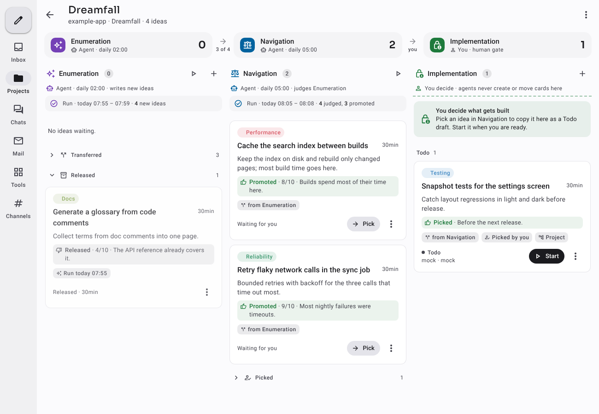
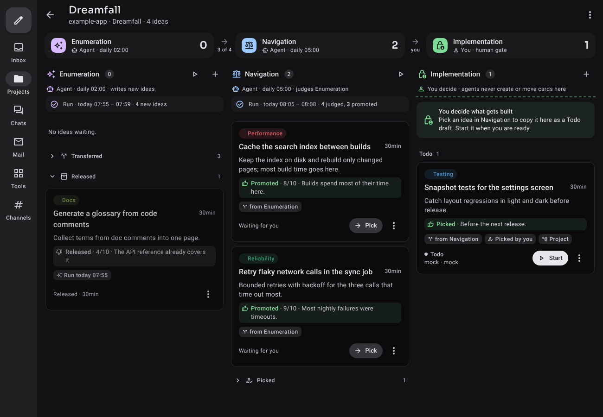

# Proposal: Dreamfall (staged idea pipelines across boards)

Status: proposal 2026-10-29, not implemented in this repository · a working
prototype runs outside it, built only on the public CLI, as an add-on with
its own page · scope proposed here: a per-board agent policy, card provenance and
(optionally) schedule ordering in the daemon; later, if wanted, a pipeline
record and a pipeline view in the Kotlin core and the three clients ·
prototype screenshots (invented example data) in
[`assets/dreamfall-prototype-light.png`](assets/dreamfall-prototype-light.png)
and [`assets/dreamfall-prototype-dark.png`](assets/dreamfall-prototype-dark.png)

## TL;DR

Scheduled agents are good at producing ideas and bad at deciding which ones
deserve a person's time. A common setup is a funnel of boards: a nightly agent
**enumerates** ideas onto one board, a second agent **navigates** them (keeps
the strong ones, releases the rest) onto a second board, and the user
**picks** what gets implemented on a third board that no agent touches.

Dieter can run this today with two schedules, three boards and board prompt
templates. The prototype has done so on a real project. It also shows three
things that only hold by convention:

1. **Nothing stops an agent from writing to the human board.** The
   Implementation board is "human only" because no schedule targets it and the
   prompts say so.
2. **A copy doesn't know its source.** Provenance lives in the brief as text
   and in a side record in `kv`; a client can't show "copied from …".
3. **Stage order is clock time.** Navigation runs at 05:00 because Enumeration
   usually finishes before then; the prototype makes the Navigation agent
   poll a `kv` key to wait.

The proposal, in steps that are each useful on their own:

- **Step 1 — human-only boards.** A board flag that refuses card creation on,
  and moves into, the board from an agent turn (a turn token), exactly as
  mail already refuses reads from a turn token.
- **Step 2 — card provenance.** `CreateCard` accepts a source card; the card
  records it in a replicated field; clients show "copied from" / "copied to".
- **Step 3 — schedule ordering (optional).** A schedule may wait for another
  schedule's latest occurrence before it starts.
- **Step 4 — pipelines (only if wanted after 1–3).** A replicated pipeline
  record that orders boards into stages, and a pipeline view in the clients:
  a funnel strip, the stages side by side, Pick on the last agent stage, and a
  per-card trail.

No web UI is proposed. The prototype's page belongs to the add-on and stays
there.

## 1. Goals and non-goals

Goals:

1. A board can be reserved for people: agent turns cannot create cards on it
   or move cards into it, on every route, enforced by the daemon.
2. A card created as a copy of another card says so, on every machine and in
   every client, without parsing its brief.
3. A multi-stage agent setup can express "run after that schedule" instead of
   "run two hours later".
4. If the maintainers want it: a first-class pipeline that turns three boards
   and two schedules into one object with one view.

Non-goals:

- Configurable lanes. Lanes stay `Todo, Running, [Review], Done`
  (`internal/model/model.go:89`, `WorkflowLanes`). A stage gives the existing
  lanes a meaning; it doesn't add lanes.
- Per-board parallelism caps or any global admission change.
- A web UI, or anything in the gateway beyond what replication already does.
- Migrating the prototype's `kv` records. That stays the add-on's job.

## 2. What exists today (code facts)

### 2.1 Boards and lanes

| What                    | Where                                                                                                                                                             |
| ----------------------- | ----------------------------------------------------------------------------------------------------------------------------------------------------------------- |
| Lanes                   | `LaneTodo`, `LaneRunning`, `LaneReview`, `LaneDone` (`internal/model/model.go:35-38`); `WorkflowLanes(workflow)` adds Review only for the review workflow (`:89`) |
| Board record            | `Board` (`api/proto/dieter/v1/common.proto:77`): `workflow`, `prompt_template`, `remote_publish_mode`, `done_archive_policy`, labels, lanes                       |
| Replicated board fields | `DomainFields["board"]` (`internal/replication/schema/domain.go:18`): `name`, `description`, `promptTemplate`, `workflow`, … — each field its own register        |
| Board operations        | `BoardService` (`boards.proto:12`): create, rename, retire, archive policy, hostnames, git settings, labels                                                       |
| Card placement          | `MoveCard` (`internal/api/cards.go:94`) → `Kanban.MoveCardBetween`; `MoveCardRequest` carries lane and neighbours (`cards.proto:91`)                              |
| Client rules            | `apps/kotlin/core/runtime/.../core/board/` (`BoardPresentation.kt`, `BoardOperations.kt`, `BoardView.kt`, `Lanes.kt`)                                             |
| Client views            | Compose `ui/.../mobile/board/BoardScreen.kt`; Mac `Features/Board/Model/BoardProjection.swift`, `Views/KanbanView.swift`                                          |

### 2.2 Turn identity is the precedent for step 1

- `turnCaller` (`internal/api/vault.go:185`) resolves a live turn token on the
  local route to its card. Remote callers never carry a turn token.
- `capabilityCaller` (`vault.go:208`) and `grantMail` stop an agent turn from
  granting mail access to a conversation it creates.
- `mailOperator` (`internal/api/mail.go:46`) refuses every mail operation but
  sending when a turn token is present
  ([ADR 0004](../adr/0004-agent-mail.md)).

A human-only board is the same check on two more operations: card creation
(`idempotentConversation`, `internal/api/conversation_snapshots.go:136`) and
`MoveCard`.

### 2.3 Card origin and forks are the precedent for step 2

- `Card.origin` is a `CardOrigin` (`common.proto:203`: `kind`,
  `schedule_id`, `schedule_run_id`, `scheduled_for`). It links cards created
  by automations to their occurrence; user-created cards leave it unset
  (`internal/model/model.go:484`). It is owner-local: the replicated `item`
  record (`domain.go`) has no origin field, so other machines don't see it.
- `ForkChatRequest.source_card_id` (`cards.proto:76`) and
  `Card.merged_into_card_id` already name one card from another.
- Creation is idempotent per `client_id` + `command_id`
  (`conversation_snapshots.go:136`), which is per caller, not per source.

### 2.4 Schedules

`Schedule` (`schedules.proto:36`) targets one board and carries `cron`,
`timezone`, `title_template`, `prompt_template`, `open_card_policy` and
`misfire_policy`. Schedules know nothing about each other.

### 2.5 The account `kv` store

`KVService` (`kv.proto`) is account-wide and replicated. Values are capped at
`crdt.MaxValueBytes` = 32 KiB (`internal/replication/crdt/store.go:20`); a
daemon serves at most 64 concurrent `WatchKV` streams (`internal/api/kv.go:134`).
The prototype keeps all its records here (§3).

## 3. The prototype

The prototype adds a "Dreamfall board" next to a project's Kanban boards. Its
New board form asks for the categories to enumerate, the number of ideas per
category and night, and the _navigation logic_ in plain language (what makes
an idea worth the user's time, how selective to be). It then creates three
ordinary boards, their labels and two schedules.

| Stage              | Actor                   | Queue (= Todo) means   | Leaving the queue                                                                                                    |
| ------------------ | ----------------------- | ---------------------- | -------------------------------------------------------------------------------------------------------------------- |
| **Enumeration**    | agent, nightly          | waiting for Navigation | _transferred_: copied to Navigation's Todo, original to Done; _released_: to Review with the agent's one-line reason |
| **Navigation**     | agent, later that night | waiting for the user   | _picked_ by the user (copied to Implementation as a Todo draft), _parked_, or released                               |
| **Implementation** | the user only           | picked, not started    | started like any card                                                                                                |

The view shows a funnel strip on top (each stage's actor, schedule, last run,
waiting count, pass rate such as "3 of 4", and "you" at the gate) and the
stages side by side (as tabs on a phone). Released, transferred, parked and
picked ideas collapse into groups under each queue. A card's detail adds
**Provenance** (its copies across stages) and a **Trail** (who created,
judged, transferred, picked, parked or started it, when and why).

Agents act through a small command shipped in the add-on image (`run begin`
/ `run end`, `ideas`, `add`, `queue`, `promote`, `release`), which wraps
`dieter card`, `dieter kv` and `dieter schedule`. Records live in `kv`
namespace `dreamfall`: one per pipeline, one per card (verdict and the last 80
trail events), one per run. A copy's brief ends with an HTML comment naming
its source, so a transfer stays idempotent even when an agent crashed before
writing its record.

What the prototype taught:

- **The shape works on plain boards.** One board per stage keeps schedules,
  prompt templates, labels and publishing mode per stage, and every stage
  still opens as a normal board.
- **Convention is not enforcement.** An agent that calls `dieter card create`
  on Implementation is not stopped; the prototype can only flag the card
  "added outside Dreamfall" afterwards (step 1).
- **Provenance in text is fragile.** Briefs get edited, records lag behind
  crashed turns, and no native client can show the link (step 2).
- **Clock ordering needs a busy wait.** Navigation's run checks a `kv` key
  for Enumeration's latest run and waits while it is running (step 3).
- **The trail is what makes the funnel trustworthy.** "Why was this
  released?" and "who picked this?" need an answer on the card itself.

## 4. Design

### 4.1 Step 1 — human-only boards

- `Board.agent_policy`: `"allow"` (default, today's behaviour) or
  `"human_only"`. A new replicated board field `agentPolicy` (one register,
  like `doneArchivePolicy`). Changed with `SetBoardAgentPolicy` and
  `dieter board policy <board> --agents allow|human-only`.
- On a `human_only` board, from an agent turn (`turnCaller` → `ok`):
  - `CreateCard` with that `board_id` → `PermissionDenied` ("this board is
    reserved for people; ask the user to pick or create the card");
  - `MoveCard` of a card on another board into it → `PermissionDenied`;
    moves within the board and starting its cards stay allowed (an agent
    working a picked card must be able to finish it).
- Schedules: `CreateSchedule` / `UpdateSchedule` targeting a `human_only`
  board from an agent turn → `PermissionDenied`. Occurrences of existing
  schedules are created by the daemon, not a turn, and are not affected;
  creating such a schedule as the operator stays possible.
- Operators, local scripts without a turn token and remote devices are
  unaffected.
- Turn instructions: when a turn's project has `human_only` boards, name them
  in one line, so agents don't try and fail.

### 4.2 Step 2 — card provenance

- `CreateConversationRequest.source_card_id` (board scope only). The daemon
  checks the source exists in the same project.
- `Card.source_card_id`, set only at creation, never inherited by forks and
  merges. Replicated as a new `item` field `source` (one register, an ID only,
  no content), so every machine and client sees it.
- Optional `CreateConversationRequest.unique_per_source`: if a live card on the
  target board already has this source, return it instead of creating a
  second one. This is the idempotency a funnel needs ("transfer each idea
  once"), and it holds across callers, unlike `client_id` + `command_id`.
- CLI: `dieter card create --source <card> [--unique-per-source]`;
  `dieter card show` prints the source and the cards copied from it.
- Clients: a "Copied from <board> · <title>" row in card detail that opens the
  source, and "Copied to …" rows on the source (derived in the core from the
  replicated field; no new RPC).

### 4.3 Step 3 — schedule ordering (optional)

- `Schedule.after_schedule_id` (same project) and `after_wait`, a bounded
  duration (default 2 h, maximum 12 h).
- When an occurrence comes due and the predecessor's latest occurrence is
  still running, the occurrence waits up to `after_wait`, then follows its
  `misfire_policy`. The occurrence history records "waited 14 min for
  Enumeration" or "skipped: Enumeration still running".
- Cycles are refused at save time.
- Only the predecessor's _latest_ occurrence counts; there is no backlog.

### 4.4 Step 4 — pipelines (only if wanted)

If steps 1–3 land and the view is wanted in the native clients, a pipeline
becomes a record, not a convention:

- `PipelineService` (`pipelines.proto`): create, get, list, update, delete;
  `Transfer`, `Release`, `Restore`, `Pick`, `Park`; `ListPipelineCards`.
  `Pick` refuses a turn token.
- A replicated `pipeline` record: name, project, ordered stages (role, board,
  actor `agent | human`, schedule), and the stage prompt settings (categories,
  ideas per category, navigation logic, implementation instructions).
- A per-card stage record for the verdict (kind, rationale, score, actor, run)
  and a bounded trail. The prototype keeps the last 80 events per card in one
  `kv` value; under the 32 KiB register limit this needs a smaller cap, or one
  record per event with a ring as agent channels do.
- Creating a pipeline creates the boards (the human stage `human_only`), the
  labels, and the schedules (the second `after` the first) with stage prompt
  templates. Removing it deletes the schedules and keeps boards and cards.
- Core rules in `apps/kotlin/core/runtime/.../core/pipeline/`: funnel counts
  and pass rates, grouping of left-the-queue cards by meaning (released,
  transferred, parked, picked), trail rows. Views: a pipeline screen in
  Compose (stages side by side, tabs below 600 dp) and on the Mac next to
  `Features/Board/`.

## 5. Phasing

Each step is its own pull request with the CLI parity checklist from
[AGENTS.md](../../AGENTS.md#adding-or-changing-an-operation-cli-parity).

### 5.1 Human-only boards

**Targets:** `api/proto/dieter/v1/common.proto` (`Board`), `boards.proto`,
`internal/replication/schema/domain.go`, `internal/api/cards.go`,
`internal/api/conversation_snapshots.go`, `internal/api/schedules.go`,
`internal/cli/commands.go`, prompt instructions,
`apps/kotlin/core/.../admin/BoardAdmin.kt`, board settings in Compose and on
the Mac, `site/content/docs/projects.md`.

**Gate:** an agent turn is refused on create, move-in and schedule-to for a
`human_only` board and allowed elsewhere; the operator and remote devices are
not; the flag replicates to a peer and is enforced there; e2e over local,
direct TLS and relay.

### 5.2 Card provenance

**Targets:** `cards.proto`, `common.proto` (`Card`), `domain.go` (`item`),
`internal/store/kanban`, `internal/api/conversation_snapshots.go`, CLI,
core card presentation, card detail in Compose and on the Mac,
`site/content/docs/automation.md`.

**Gate:** source set once and visible on a peer; `unique_per_source` returns
the existing card under concurrent creates from two turns; forks and merges
don't inherit it.

### 5.3 Schedule ordering

**Targets:** `schedules.proto`, `internal/engine/scheduler`, occurrence
history, CLI, schedule editors, `automation.md`.

**Gate:** wait, give up and cycle refusal covered by deterministic scheduler
tests; history explains each wait.

### 5.4 Pipelines

Starts with an ADR, after 5.1–5.3 and with maintainer agreement.

## 6. Open questions for maintainers

1. Is a per-board agent policy welcome, and is "move within the board is
   allowed" the right line for agents working on a picked card?
2. Should provenance be one generic `source_card_id`, or a new
   `CardOrigin.kind = "copy"` made replicated?
3. Is schedule ordering worth its scheduler complexity, or is a prompt-level
   wait acceptable?
4. Step 4: is a pipeline something Dieter should know about, or should it stay
   a client convention on top of steps 1–3? If yes, may Android ship first?
5. Naming: "Dreamfall" is the prototype's name. "Pipeline" or "Funnel board"
   may read better in the product.

## 7. Alternatives considered

- **One board with configurable lanes.** Needs per-lane permissions and
  per-lane schedules, and breaks fixed workflow positions. Several boards
  keep every existing per-board setting meaningful.
- **Keep everything in prompts and `kv`.** Works (the prototype), but leaves
  the three gaps in §TL;DR and keeps the view out of the native clients.
- **A web view.** Dieter has no web UI ([invariants](../invariants.md)); the
  prototype's page exists only because its host environment has no native
  client.
