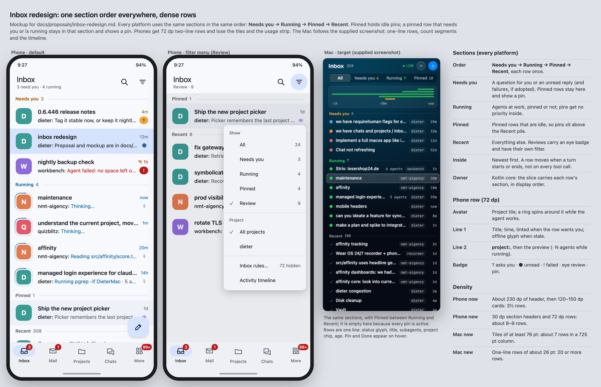
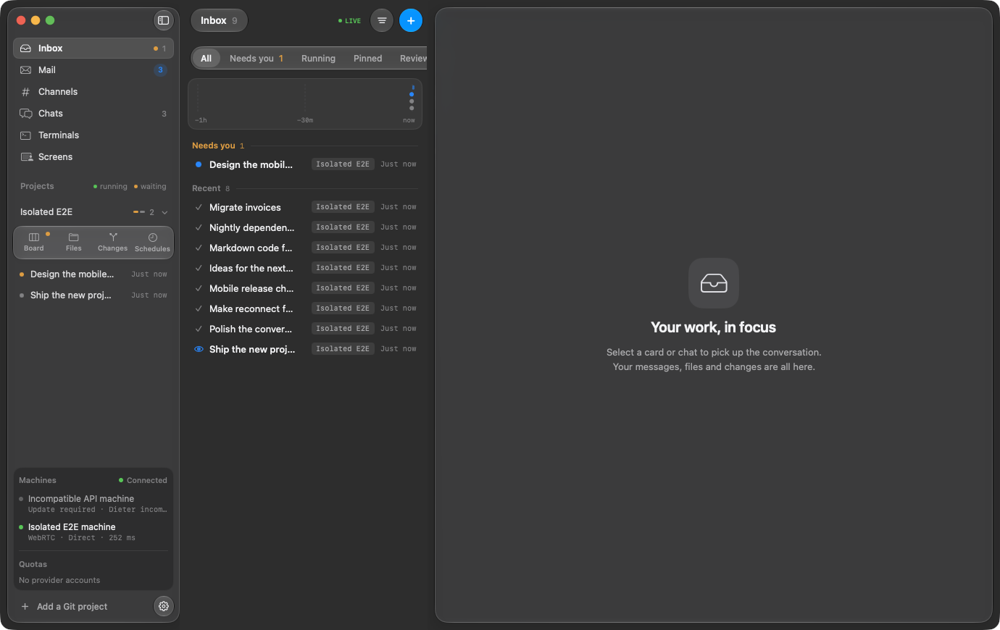
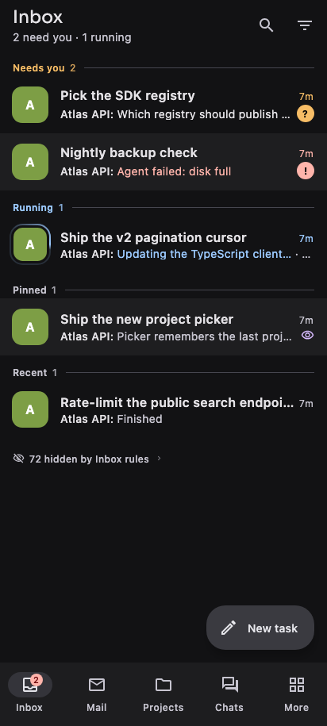

# Proposal: Inbox redesign — one section order, dense rows

Status: implemented 2026-11-15 (proposed, revised after review and built the
same day; see §13 for where the build differs from the plan) · scope: Kotlin
core activity slice (`apps/kotlin/core/runtime`), client API
(`api/proto/dieter/client/v1`), shared Compose UI (`apps/kotlin/ui`: phone,
tablet, Android desktop shell), the Mac Inbox (`apps/apple/mac`), Maestro flows
and the user guide. Related: `docs/proposals/project-free-chats.md`
(card `c_49b9d4b5e519`, not merged yet) changes the same Inbox files; see §7.

Mockup: [assets/inbox-redesign-mockup.html](assets/inbox-redesign-mockup.html)
(rendered: [assets/inbox-redesign-mockup.png](assets/inbox-redesign-mockup.png)).
Mac target: [assets/mac-inbox-target.png](assets/mac-inbox-target.png), the
screenshot supplied in review.



## TL;DR

On a phone the Inbox shows about three and a half conversations before you
scroll. Count tiles, a usage strip and a "hidden by rules" link take about
230 dp. Each running conversation then takes a 120–150 dp card, mostly padding
and a "Thinking…" box. The order isn't obvious either:

- **Phone:** Running (pinned rows first), then Pinned, then Needs you, then
  Review, then Recent.
- **Mac:** Pinned, then Running, then Needs attention, then Recent, in 76 pt
  tiles.

The grouping rules live in UI code on both platforms, and they have drifted
apart.

This proposal:

1. **One section order on every platform, owned by the core:**
   **Needs you → Running → Pinned → Recent**. Each row appears once. Pinned
   holds pinned rows that are idle. A pinned row that needs you or is running
   stays in that section and shows a pin, so pins never push other rows
   around inside a section. Within a section, rows are newest first: a row
   moves when a turn starts or ends, not on every tool call.
2. **Phone and tablet: Telegram-style 72 dp rows** under slim 30 dp section
   headers.
   - Line 1: project avatar, title, time.
   - Line 2: `project:` and the preview, plus one status badge.
   - A running agent gets a spinning ring and a blue preview line.
   - The tiles, the usage strip and the top "hidden" link go. Their
     information moves to the subtitle (`3 need you · 4 running`), the filter
     menu (status filters with counts, `Inbox rules… 72 hidden`) and a footer.
     Plan usage stays under **More** › **Providers**.
3. **Mac: the supplied design.**
   - Header: a title with a count, LIVE, a filter menu and a round `+` button.
   - Count segments: All · Needs you · Running · Pinned (and Review).
   - A compact timeline.
   - Section headers with a rule.
   - One-line rows of about 26 pt: status dot, title, `N agents`, project
     chip, age.
   - Pin and Done appear on hover.

First screen: phone 3½ → 8–9 rows; Mac (725 pt column) about 7 → 20 or more.

## 1. Findings

### 1.1 Space

Phone (2026-11-15 screenshot, Android, 412 dp wide; viewport between the bars
≈ 765 dp):

| Element                                    | Height   |
| ------------------------------------------ | -------- |
| Pulse tiles (Running / Needs you / Review) | ≈ 85 dp  |
| Usage strip (OpenAI, Claude)               | ≈ 50 dp  |
| "72 hidden by Inbox rules"                 | ≈ 35 dp  |
| "Running 4" section header                 | ≈ 55 dp  |
| **Before the first row**                   | ≈ 230 dp |
| Running card, one-line title               | ≈ 120 dp |
| Running card, two-line title               | ≈ 150 dp |
| Telegram row, for comparison               | ≈ 70 dp  |

Within a running card, the title, project and time take about 45 dp. The rest
is padding, a gap and a callout box that usually says "Thinking…". The ring and
the bottom sweep already say that.

Mac (`InboxFeed.swift`): every row is a tile of at least 76 pt:

- an accent bar;
- a title of up to two lines;
- project · board · kind;
- the live step;
- a status line;
- an always-visible pin button and a Done button.

The header adds a counts line, a search field, a project menu and the
hidden-by-rules text before the timeline.

### 1.2 Order

| Surface                        | Order                                                       | Where the rule is                   |
| ------------------------------ | ----------------------------------------------------------- | ----------------------------------- |
| Core slice                     | pins first, then `sortAt` newest first                      | `RuntimeSlices.kt` `activitySlice`  |
| Phone, tablet, Android desktop | Running (pins first) → Pinned → Needs you → Review → Recent | `ui/.../workspace/InboxSections.kt` |
| Mac                            | Pinned → Running → Needs attention → Recent                 | `InboxFeed.swift`                   |
| Widgets, island, menu bar      | attention / running / recent summaries                      | core                                |

Effects:

- **Pins.** On the phone a pin leaves **Pinned** whenever its agent runs and
  comes back when the agent stops. Inside Running, pinned rows come first
  because the core sorts pins first.
- **Needs you.** On the phone, Needs you comes after all running work and all
  pins, so it is usually below the first screen.
- **Placement.** AGENTS.md puts client rules in the Kotlin core. Yet the
  sections are decided twice in UI code and have drifted: the Mac has no
  Review section and puts pins first.

The core's within-group order is the useful one. `Activity.project` sorts a
running row by its turn start (`runtime_updated_at`) and any other row by its
latest activity (`at`). Reading, renaming and moving don't change `at`.
`last_activity_at` advances while an agent streams, but a running row's
`sortAt` doesn't.

### 1.3 Repetition

- On the phone, the tile counts repeat the section counts. The Needs-you count
  also sits on the Inbox tab badge.
- A status shows up to four times per phone card: the avatar badge, the tinted
  time, the callout icon and its text.
- Usage has its own page under **More** (**Providers** since PR #216).

## 2. Shared rules (core)

### 2.1 Sections and order

| #   | Section   | Rows                                                                                                      |
| --- | --------- | --------------------------------------------------------------------------------------------------------- |
| 1   | Needs you | `ANSWER` (waits for your answer), `UNREAD` (reply not yet seen), and `FAILED` if adopted (§9, question 1) |
| 2   | Running   | `RUNNING`, pinned or not                                                                                  |
| 3   | Pinned    | pinned rows not in 1 or 2                                                                                 |
| 4   | Recent    | everything else: review, failed (if not in 1), finished                                                   |

- A row is placed in the first section that matches, so it appears once.
  Pinned rows in Needs you or Running keep `pinned = true` and show a pin.
- **Within a section:** `sortAt` newest first, ties by ID. Pins get no
  priority inside a section; the core's `sortedByDescending { pinned }` goes.
- **No Review section.** Review rows sit in Recent (or Pinned) with an eye
  badge, and the **Review** filter lists them. The Mac target has no Review
  section either.
- The core sets `ActivityRow.section`. `ActivitySlice.rows` is in display order
  (section, then `sortAt`). Clients draw a header where the section changes.
  They never regroup or re-sort; they only filter.
- "Needs attention" becomes **Needs you** everywhere: the Mac header, the
  widget section title (`ActivitySection.ATTENTION.title`) and the island's
  accessibility text.
- Widgets, the island and the menu bar keep their own small selections (§12).

### 2.2 Filters and counts

- **Filters:** All · Needs you · Running · Pinned · Review.
  - **Pinned** matches every pinned row, whatever its section. The Mac
    screenshot shows "Pinned 10" while the Pinned section is empty because
    every pin is active.
  - A filter keeps the sections: for example, the Review filter shows the
    Pinned and Recent rows that are in review.
- **Counts:** the core owns the filter rule (`InboxStatus.matches`, exported to
  the Mac as `SharedRules.inboxStatusMatches`). Clients count with it over the
  rows they show after search and the project filter, so the counts follow
  those filters. Section headers count their own rows.
- This is the status side of the core-owned Inbox filter that
  `project-free-chats.md` introduces (All / Chats / Cards / each project). They
  are one `InboxFilter` with two dimensions, status and scope (§7).

### 2.3 Row text

| Field                     | Rule                                                                                                                                                                                                                                                                                           |
| ------------------------- | ---------------------------------------------------------------------------------------------------------------------------------------------------------------------------------------------------------------------------------------------------------------------------------------------- |
| `preview` (new)           | Running: the live step (`detail`). Answer, unread, review: `card.summary`, else "Waiting for your answer", "New reply" or "Ready for review". Failed: "Agent failed", plus ": summary" when present. Recent: summary, else `detail`. Plain text, whitespace collapsed, at most 200 characters. |
| `agents` (new)            | "6 agents" from `card.active_subagents`; "1 agent"; empty when there are none.                                                                                                                                                                                                                 |
| `headline` (new, summary) | "3 need you · 4 running"; a zero part is left out; "All caught up" when both are zero.                                                                                                                                                                                                         |

## 3. Phone and tablet (shared Compose UI)

### 3.1 Top bar

- Title "Inbox" (small, as today) and a subtitle, first match wins:
  1. A filter or project is chosen: `Review · 9`, `dieter · 12`,
     `dieter · Review · 3`.
  2. Otherwise `headline`.
- **Search:** a toggle, as today; no permanent height.
- **Filter menu:**
  - **Show:** All, Needs you, Running, Pinned and Review, each with its count.
    This replaces the tiles. The button shows as checked while a filter is on.
  - **Project:** All projects, then each project.
  - **Inbox rules…** with `72 hidden` as its trailing text, and **Activity
    timeline**.
- **Removed:** `InboxPulse` / `PulseTile`, `UsageStrip` / `UsageGauge`, and the
  top `HiddenByRules` link. The link becomes a footer after the last row
  (`72 hidden by Inbox rules ›`, tag `inbox-hidden`).
- The connection notice and the opt-in timeline stay above the list. The FAB
  already collapses on scroll (`Chrome.kt`).

### 3.2 Section headers

The header is 30 dp: the title and count in footnote SemiBold, then a hairline
rule to the right edge, as on the Mac target.

- Colour: Needs you in warning, Running in info, Pinned and Recent in
  secondary.
- No icons.
- Tag: `inbox-section-<needs_you|running|pinned|recent>`.
- An empty section has no header.

### 3.3 Row

```
┌──────────────────────────────────────────────────────────────┐
│ ╭─────╮  Title, one line, ellipsized ………………        [◌] time │
│ │  D  │  project: preview, one line · 3 agents …      [badge] │
│ ╰─────╯                                                       │
└──────────────────────────────────────────────────────────────┘
  46 dp      16 sp semibold / 14.5 sp regular                72 dp min
```

- **Size.** `heightIn(min = 72.dp)`, so the row grows with the font scale.
  Full-bleed: no card, no shadow, no rounded group. On iOS a hairline starts at
  the text; on Android there is none.
- **Avatar.** `ProjectAvatar` at 46 dp, a rounded square. Unfiled chats show
  the chat glyph tile. A running row gets the existing `RunningRing`. The
  avatar has no status badge.
- **Line 1.** Title, one line, SemiBold; unfiled chats get a small chat glyph
  in front. On the right:
  - the age, tinted in the badge colour when the row wants you, or info while
    it runs;
  - an offline glyph (warning tint) in front of the age when `stale` is set.
- **Line 2.** `project:` (Medium, label colour), then `preview`, then
  `· agents` while running, all on one line.
  - Preview colour: info while running, label when the row needs you, error
    when failed, secondary otherwise.
  - Project-free chats have no project, so the prefix is the machine when the
    account has more than one machine (`project-free-chats.md` §2.4), and
    nothing otherwise.
- **Badge slot.** One item, first match wins:

  | Row                       | Badge               | Glyph / colour   |
  | ------------------------- | ------------------- | ---------------- |
  | `ANSWER`                  | filled 22 dp circle | `?`, warning     |
  | `UNREAD`                  | filled 12 dp dot    | accent           |
  | `FAILED`                  | filled 22 dp circle | `!`, destructive |
  | `REVIEW`                  | glyph only          | eye, purple      |
  | pinned, none of the above | glyph only          | pin, tertiary    |
  | `RUNNING`, `RECENT`       | none                | —                |

  In the Pinned section the pin glyph is left out: the section already says
  it. There are no numeric counts: `response_seq` is a journal sequence, not a
  count (§11).

- **Pinned rows** in any section sit on a faint tint (`palette.cell`).
- **Selected** (two-pane): `accentContainer` fill.
- **Accessibility:** one merged node, for example "maintenance, nmt-aigency,
  running, Thinking…, started 20 minutes ago, pinned".
  - Row tags stay `activity-row-<id>`.
  - The badge is tagged `inbox-badge-<kind>`.
  - A pinned row adds `inbox-pinned-<id>`.

### 3.4 Interaction

- Tap opens the conversation. Long press opens the existing menu, headed by
  `project · machine` and the stale note.
- Swipes don't change. Right: read, finish a review, or pin/unpin. Left:
  archive (with Undo), or stop a running agent.
- The inline Done buttons (`FinishChip`, the check in `CompactRow`) go; swipe
  right and **Mark done** in the menu remain.

### 3.5 Android desktop shell

`DesktopLists.kt` keeps its tile look and segments. It reads `section` from
the slice instead of `inboxSections`. Its headers become Needs you / Running /
Pinned / Recent, and its segments become All · Needs you · Running · Pinned ·
Review with counts from the summary.

## 4. Mac

The target is the supplied screenshot. Colours, fonts and radii come from
`DieterTheme`.

### 4.1 Header

- **Leading:** `DieterTitleCapsule("Inbox", count)`; the count is all rows
  after rules (319 in the screenshot).
- **Trailing:**
  - the LIVE / CACHED indicator, moved here from the timeline card;
  - a round filter button whose menu holds Search… (⌘F), Project ▸, Timeline
    range ▸, and **Inbox rules…** with the hidden count;
  - a round prominent `+` button (New task, the existing popover).
- **Removed:**
  - the "N running · N need attention" line (the segments carry the counts);
  - the always-visible search field (⌘F or the menu shows it above the
    segments, and it stays while a query is set);
  - the inline project menu (now in the filter menu);
  - the "hidden by Inbox rules" text (now a footer and a menu item).

### 4.2 Segments

All · **Needs you** N · **Running** N · **Pinned** N · Review N.

- Each count is tinted with its section colour: attention amber, running green,
  others tertiary.
- One control. It scrolls sideways when the column is narrower than its
  content, which is why the screenshot cuts off after Pinned.
- Selecting a segment applies the core filter (§2.2).
- IDs: `inbox.filter.<all|needs-you|running|pinned|review>`.

### 4.3 Timeline

This is the existing `InboxTimelineChart` card, compacted:

- no LIVE row;
- axis labels `−1h · −30m · now`;
- height about 70 pt;
- the range in the filter menu.

It stays visible by default, as in the screenshot.

### 4.4 Sections

- **Header:** the title in its colour (Needs you amber, Running green, Pinned
  and Recent tertiary), the count, then a hairline rule. IDs stay
  `inbox.section.<needs-you|running|pinned|recent>`.
- **Grouping:** rows are grouped by `row.section` in slice order. The four
  `filtered.filter { … }` calls go.
- **Paging:** "Show more activity" applies to Recent only. The other sections
  are short and always complete.

### 4.5 Row

```
●  maintenance                                  nmt-aigency   10m
```

The row is about 26 pt tall and laid out on one line:

| Part         | Spec                                                                                                                                           |
| ------------ | ---------------------------------------------------------------------------------------------------------------------------------------------- |
| Status       | 8 pt dot. Running green, answer amber, unread action blue, failed red. Recent: grey checkmark glyph. Review: eye glyph in action blue.         |
| Title        | 13 pt, one line, truncated at the tail.                                                                                                        |
| Agents       | `agents` ("6 agents"), mono 10 pt, tertiary, only when non-empty.                                                                              |
| Project      | mono 10 pt chip on a subtle capsule (`DieterTheme` tile fill). Project-free chats: the machine badge (`project-free-chats.md`).                |
| Age          | mono 10 pt, tertiary, right-aligned. Amber offline glyph in front when stale.                                                                  |
| Pinned       | small pin glyph after the title, outside the Pinned section. The hidden e2e target `inbox.pinned.<id>` is on every pinned row, in any section. |
| Selected     | rounded rect with a 1 pt border, as in the screenshot (`InboxRowSelection`).                                                                   |
| Hover        | pin / unpin and, for reviews, Done replace the age. They are hover-only, with IDs `inbox.pin.<id>` and `inbox.finish.<id>`.                    |
| Tooltip      | `preview`, which carries the live step that today's row prints.                                                                                |
| Context menu | unchanged (`BoardCardContextMenu` / `ChatContextMenu`), plus Pin / Unpin in Inbox.                                                             |

The hidden e2e targets `inbox.title.<id>.<title>` and
`inbox.status.<id>.<KIND>` stay, so flows keep their selectors. The row keeps
`.equatable()` and the `rowIdentity` rule.

## 5. Core and API changes

### 5.1 Proto (`api/proto/dieter/client/v1/client.proto`)

```proto
message ActivitySlice {
  // In display order: by section (needs you, running, pinned, recent), then
  // newest first within a section (a running row by its turn start, any other
  // by its latest activity). Clients filter but never reorder or regroup.
  repeated ActivityRow rows = 1;
  …
}

message ActivitySummary {
  …                       // running, attention, recent, review, subagents, hidden
  string headline = 7;    // "3 need you · 4 running", "All caught up"
}

message ActivityRow {
  enum Section {
    SECTION_ATTENTION = 0;  // "Needs you"
    SECTION_RUNNING = 1;
    SECTION_RECENT = 2;
    SECTION_PINNED = 3;     // idle pinned rows
  }
  Section section = 3;      // now the Inbox section, set by the core
  …
  string preview = 18;
  string agents = 19;       // "6 agents"; empty with none
}
```

The existing enum numbers stay and `SECTION_PINNED` is added. Display order
comes from row order, not enum values. This is the in-process core ↔ app
contract, so the daemon and gateway are unaffected. Run `just generate` for
Kotlin and Swift.

### 5.2 Kotlin core

- `core/activity/Activity.kt`:
  - `InboxSection` and `Activity.inboxSection(item, pinned)`;
  - `Activity.inboxOrder(items, pins)`: section, then `sortAt`, then ID;
  - `ActivityItem.preview`, `ActivityItem.agents`, `Activity.headline(counts)`;
  - `ActivitySection.ATTENTION.title = "Needs you"`.
- `core/activity/` status filter: `InboxStatus` (all, needsYou, running,
  pinned, review) with `matches(row)`, exported through `SharedRules` for the
  Mac. It merges with the scope filter from `project-free-chats.md` (§7).
- `core/client/RuntimeSlices.kt`: `activitySlice` uses `inboxOrder` in place of
  `sortedByDescending { it.id in pins }`, and sets `section`, `preview`,
  `agents`, `pinned`, `total` and `headline`.
- If question 1 (§9) is adopted, `ActivityKind.FAILED.needsYou = true`. That
  flows into the counts, the tab badge, widgets and the island in one place.

## 6. Implementation plan

**Phase 1 — core** (one change)

- Everything in §5. Tests listed in §8.

**Phase 2 — phone, tablet and the Android desktop shell** (one change, needs
phase 1)

- `workspace/InboxScreen.kt`:
  - Delete `InboxPulse`, `PulseTile`, `UsageStrip`, `UsageGauge`, `InboxCard`,
    `CompactRow`, `StatusCallout`, `LiveCallout`, `FinishChip`,
    `RunningSweep`, `StaleNote` and the avatar badge.
  - Add `InboxRow`, `InboxBadge` and the new `InboxSectionHeader`. Move
    `HiddenByRules` to the footer.
  - Filter menu: the **Show** section with counts, and the subtitle. Drop the
    `quotas` collection.
  - Expect the file to shrink from 1,345 to about 650 lines.
- Delete `workspace/InboxSections.kt` and its test.
- `desktop/DesktopLists.kt`: §3.5.
- Rewrite `tests/maestro/mobile/inbox.yaml` (§8). Update the user guide (§10).

**Phase 3 — Mac** (one change, needs phase 1; can run in parallel with phase 2)

- `Features/Inbox/Views/InboxFeed.swift`: §4. It covers the header, segments,
  compact timeline, slice-ordered sections, the compact `InboxActivityRow`
  with hover actions, the footer and ⌘F.
- `Features/Inbox/Model/InboxActivity.swift`: `section` from the new enum.
- `InboxActivityTests` and `tests/maestro/mac/conversation.yaml` (§8).

**Phase 4 — follow-ups** (§11), on separate cards.

## 7. Coordination with project-free-chats.md

That proposal (card `c_49b9d4b5e519`, in review) touches the same files:

- `InboxScreen.kt`, `InboxSections.kt`, `DesktopLists.kt`, `InboxFeed.swift`;
- the core Inbox filter;
- `ActivityRow`, where it adds a machine badge for project-free chats;
- the leading swipe, where it adds a chat **Done** (dismiss).

The two fit together like this:

- **One core filter.** Status (this proposal) × scope (All / Chats / Cards /
  project). Exposed together in the slice.
- **Machine badge.** It is line 2's prefix (phone) or the chip (Mac) for
  project-free chats, and is absent otherwise.
- **Chat Done.** It reuses this proposal's Done affordances: phone swipe
  right, Mac hover Done, the menu.
- **Order of landing.** This proposal's phase 1 first. It is small and
  defines `section`, `preview` and the filter's status side. The chats work
  then adds scope and dismissals to the same structures. Whichever lands
  second rebases the UI files.

## 8. Verification

Start with `mise exec -- just check-changed --dry-run`. Run the selected checks
once at the end and rerun only what fails.

- **Core (commonTest)**
  - Sections: answer and unread go to Needs you (and failed if adopted);
    running goes to Running; idle pinned rows go to Pinned; review and
    finished rows go to Recent.
  - A pinned running row is in Running with `pinned = true`, and pins get no
    priority within a section.
  - Within a section, newest first. A running row doesn't move when
    `last_activity_at` advances. A finished turn and an answer request each
    move the row to the top of its new section. Reading doesn't move a row.
  - Filters: Pinned counts every pinned row, and filtering keeps sections.
  - `preview` per kind; `agents` (zero, singular, plural); `headline`.
- **Compose (jvmTest, offscreen, as in `DesktopShellUiTest`)**
  - No tiles and no usage strip.
  - Headers in section order from the slice; the `inbox-hidden` footer last.
  - Filter menu counts.
  - At font scale 1.0 a row is 72–76 dp tall.
- **Maestro `mobile/inbox.yaml`** (warm Android emulator and iOS simulator,
  `tags:smoke`)
  - Wait for `activity-feed`, then search "Ship the new project picker" (no
    scroll on the 320 × 640 CI emulator).
  - Long press → **Pin in Inbox**. The card is idle and in review, so assert
    `inbox-section-pinned` and `inbox-pinned-<id>`.
  - Swipe left → Undo → the card is gone.
  - Screenshots `inbox-pinned` and `inbox-archived`.
- **Mac unit tests** (`InboxActivityTests`) and **`mac/conversation.yaml`**
  - The flow opens the card and then pins it. Its status check still accepts
    `UNREAD`, and a card still unread when pinned stays in Needs you. So the
    flow asserts the row's pin marker (`inbox.pinned.<id>`) rather than
    `inbox.section.pinned`.
  - Pin through the context menu, because `inbox.pin.<id>` is hover-only.
  - Mac flows refuse to run while any `DieterMac` runs. If the operator's app
    is open, report that rather than closing it.
  - Check the unit test summary line; silent run-loop exits still pass.
- **Density check.** On the showcase fixture: at least 8 rows on a
  412 × 915 dp phone and at least 5 on the CI 320 × 640 emulator. On the Mac,
  at least 20 rows in a 725 pt column. Keep before and after screenshots with
  each change.

## 9. Decisions

Both open questions were answered in review (2026-11-15):

1. **Failed rows join Needs you**, as one rule everywhere: the section, the
   filter, the tab badge, widgets and the island. A failure leaves Needs you
   when the agent is retried, its card is finished (moved to a done lane) or
   it is archived.
2. **Review is a fifth Mac segment**, not a section.

Also settled in review:

- Sections stay, in the order Needs you → Running → Pinned → Recent.
- Pinned exists on every platform.
- The Mac follows the screenshot.
- Rows show no machine name, except project-free chats.
- Inline Done is replaced by a swipe (phone) and hover (Mac).

## 10. Documentation

- `site/content/docs/tour.md` ("Pick up the thread on your phone"): replace the
  tiles and the section order with the new sections, badges, filter menu and
  footer. Remove "Usage, which the Inbox shows too". In the Mac pin paragraph,
  pins sit below Running, the pin button appears on hover, and the Pinned
  filter lists all pins.
- `site/content/docs/projects.md:76`, `site/content/docs/cli.md:127`: "Needs
  attention" on the Mac becomes **Needs you**.
- Recapture `ios-inbox.png` (showcase fixture; its caption mentions provider
  quotas) and any Mac Inbox screenshot on the site.

## 11. Follow-ups (not in this change)

- **Pin order:** drag to reorder pins in the Pinned section, stored as an order
  key in the `navigation` KV namespace (as `pinned-order` does for projects).
- **Bulk selection:** multi-select for Done, Archive and Read across many
  review rows. On the phone, long press selects; on the Mac, ⇧/⌘-click.
- **Unread counts:** a daemon-side count of unread agent responses per card,
  for numeric badges.
- **Two-line previews:** an option on the phone, like Telegram's chat list
  view setting.

## 12. Non-goals

- Widgets, the Mac island and the menu bar keep their summaries. Only the
  "Needs you" wording and, if adopted, the failed rule reach them.
- No change to Inbox rules, pin storage, swipe semantics or the conversation
  screen.

## 13. As built





Where the implementation differs from or adds to the plan above:

- **Summary.** `ActivitySummary` gains only `headline`; no `pinned` or `total`
  counts. Clients count the status filters themselves with the core's rule
  (§2.2).
- **Failures.** `ActivityKind.FAILED.needsYou` is true. A failed board card in a
  done lane classifies as Recent ("Agent failed"). `can_finish` also covers
  failed board cards, so the phone's swipe right and the Mac's hover Finish can
  finish them. The menu bar lists a failure once, as actionable, not again as
  a recent result.
- **Wording.** "need attention" becomes "need you" in the widget summary, the
  island's accessibility text and the widget's section title.
  `Activity.overview` had no callers and is gone.
- **Providers on Android.** The More sheet used to leave Usage (Providers
  since PR #216) out because the Inbox showed it. It now lists Providers, with
  its usage, as the iOS More tab does; Settings links to it too.
- **Mac search.** ⌘F (only while the Inbox is the active pane, as in Mail) or
  **Search…** in the filter menu shows the field; Escape or its close button
  hides it again.

## 14. One list style across pages (2026-11-15)

After review the Inbox's style became the app's one list style on phones and
tablets (Android and iOS). It lives in `apps/kotlin/ui/.../design/Lists.kt`:

- `ListSectionHeader`: title and count in a tint, then a hairline to the edge,
  with an optional trailing control (a collapse chevron, Hide).
- `ListRow`: full-width rows with a leading avatar or `ListIconTile`, title and
  meta, an optional subtitle and badge; 72 dp with a subtitle, 56 dp without
  (the tile shrinks to 40 dp). A row without a click handler only informs.
- `rememberListSearch`: a top bar search toggle; no page keeps a permanent
  search field.
- Every primary page uses small titles with a status subtitle.

Inbox, Chats (still grouped by project), Projects and the project page, Mail,
Channels, Terminals, Schedules, Folders, the iOS More page and Devices use them.
Forms (Settings, Providers, folder settings) keep grouped cards. The Android
More sheet keeps its tile grid. Inline controls moved into long-press menus:
pausing a schedule, removing a device, restoring from a folder's trash, and
resolving a folder conflict. `PageCatalogUiTest` renders every primary page in
light and dark mode when screenshots are on.

Long-press menus on full-width Inbox rows open at the press, clamped 16 dp
inside the window (`MenuAnchor(atPress = true)`), instead of at the screen
edge.
