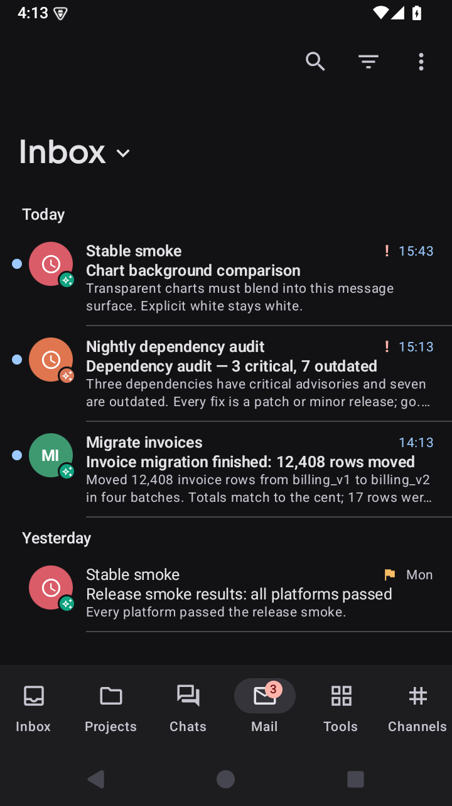
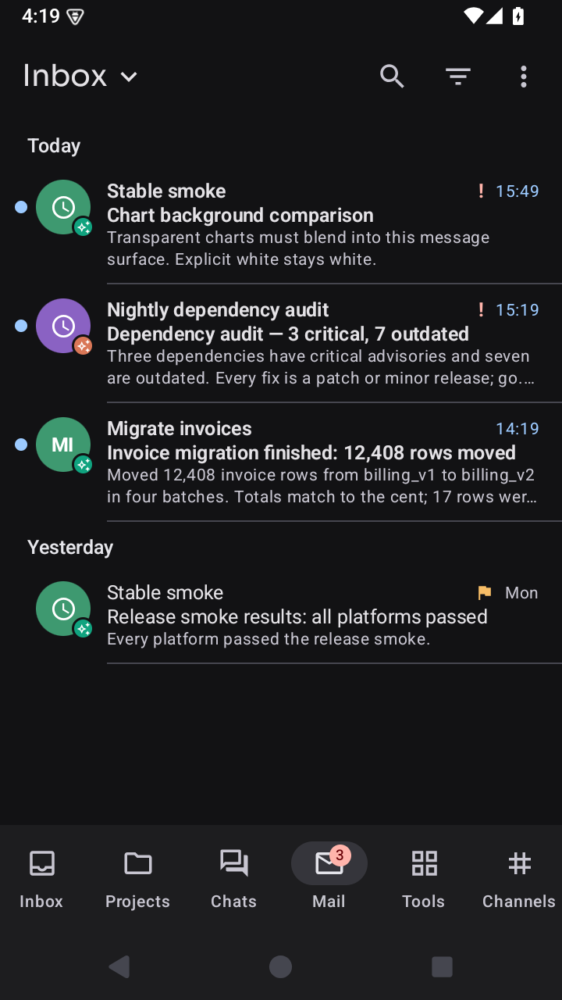
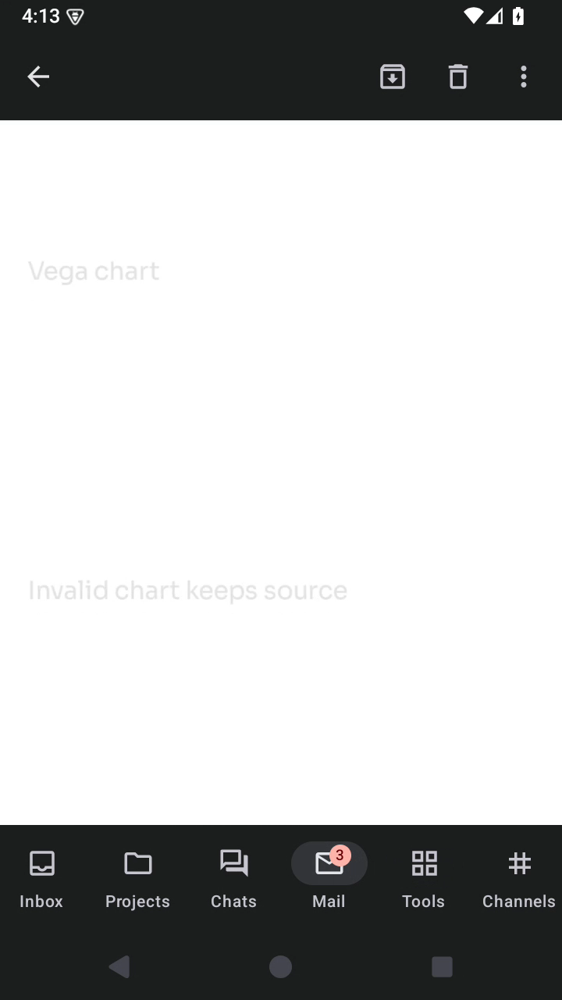
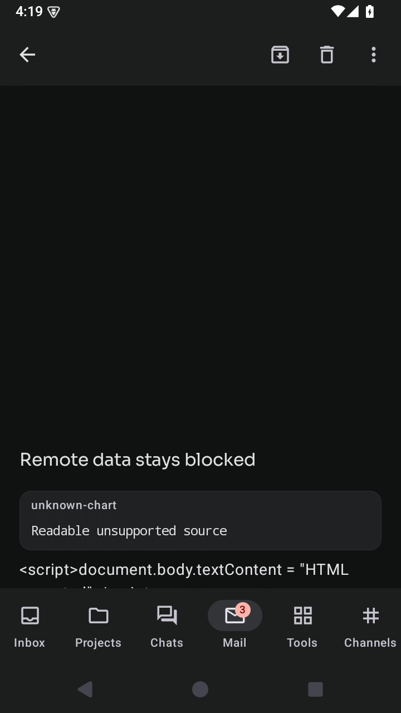

# Android Mail header and scrolling

The supplied Samsung screenshot showed the Mail mailbox title below its toolbar
actions. Fast scrolling also intermittently replaced the reader with white,
although charts eventually rendered correctly.

## Changes

Mail now uses a compact Android app bar, keeping its mailbox title/menu on the
same row as Search, Filter and More. iOS retains its large-title presentation.

The Android diagram adapter prepares the bundled HTML with the reader theme,
diagram mode and transparent document styling before its first paint. It no
longer starts from the full-preview shell's light page while waiting for the
JavaScript bundle. The CSP, resource URLs and shared SVG renderer are unchanged.

The native WebView backing follows the actual reader surface color, including
palette updates, so Chromium's hardware tile clearing cannot expose a white
surface while scrolling. Null/omitted SVG backgrounds still blend with that
reader surface; authored white SVG backgrounds remain white. Offscreen
prerasterization keeps window-sized diagrams ready during scrolling and is
disabled for views larger than the native window to bound tile allocations.
Lazy-list disposal, source fallback and offline resource restrictions remain.

## Frame evidence

Both recordings use the same Android 15 emulator, the synthetic rich Mail
fixture in dark appearance, and sixteen 80 ms swipes: eight down, eight up.
The scan covers the swipe interval plus 0.5 seconds on each side, inside the
reader viewport (640×850 pixels at 40,200 on a 720×1280 screen). Pixels with
luminance at least 220 are counted; this fixture has no authored white chart
surfaces. These measurements qualify the recorded emulator scenario, not every
Android GPU or physical phone.

| Measurement                                 | Before | After |
| ------------------------------------------- | -----: | ----: |
| Recorded scroll frames                      |    399 |   389 |
| Frames with over 10% bright viewport pixels |     18 |     0 |
| Largest bright area in one frame            |   100% | 2.32% |

The remaining bright pixels after the fix are normal text and chart marks.
The before/after scroll images show the same first downward-fling interval.
All screenshots below were opened and inspected. They use isolated synthetic
Mail; the supplied phone screenshot and report data are not committed.

| Header before                                             | Header after                                                    |
| --------------------------------------------------------- | --------------------------------------------------------------- |
|  |  |

| White flash before                                                      | Scroll frame after                                                    |
| ----------------------------------------------------------------------- | --------------------------------------------------------------------- |
|  |  |

## Verification

The final `mail-scroll` flow passed on `android-emulator` (`emulator-5554`). It
checks chart rendering after rapid scrolling, returning to the mailbox and
opening its menu. The first baseline run completed the recording and scroll
checks, then failed a popup resource-ID assertion: native popup IDs were not
exposed. That selector was corrected to its visible menu label. The failed
baseline evidence is retained; no rendering or cleanup assertion was removed.

Paths relative to this worktree:

- `tmp/pipeline/20261027T151249-android-e2e-e93d25/`: baseline screenshots and
  retained final-selector failure.
- `tmp/pipeline/20261027T151901-android-e2e-e136e8/`: passing fast-scroll/header
  flow and native screenshots.
- `tmp/mail-scroll/{before,after}/`: screen recordings, frame statistics,
  comparison images, run metadata and `analysis.json`.
- `tmp/mail-scroll/record-run.py` and `analyze.py`: local recording and
  frame-analysis harnesses. Recording runs only after the isolated E2E app
  starts; it uses the exact configured emulator serial.

`just check-changed` passed Kotlin tests/core E2E, Apple unit/component suites,
the iOS simulator build, Android lint/unit and Maestro flow lint. The Apple
suites reported zero failures; their existing opt-in remote-desktop, production
UI and privacy-hardware cases were skipped. These unrelated cases are not Mail
qualification. Explicit `just kotlin :ui:jvmTest` passed all 35 tests, including
the new check that both prepared themes preserve the bundled head and CSP.

The Android `mail-backgrounds` follow-up passed (85.7 s), covering null, omitted
and explicit-white Vega/Vega-Lite surfaces in light and dark appearance. Dark
white-background and light transparent-background captures were opened and
inspected; authored white surfaces remain white.

The shared `mail-scroll` flow also passed on iOS (59.8 s). Its large title,
rendered charts after rapid scrolling and mailbox menu were opened and
inspected. The first iOS run reached the menu but failed the exact `Flagged`
label: iOS exposes the count in `Flagged, 1`. The selector now accepts the
platform's optional numeric count. That failed run is retained; the same menu
assertion passes with the corrected selector.

Additional evidence:

- `tmp/pipeline/20261027T152939-swift-tests-c90ae6/`: Apple suite XML reports.
- `tmp/mail-scroll/ui-unit.log`: all 35 UI JVM tests passed.
- `tmp/pipeline/20261027T153515-android-e2e-e55ab2/`: passing Android background
  flow and native screenshots.
- `tmp/pipeline/20261027T153651-ios-e2e-8de40f/`: retained iOS selector failure.
- `tmp/pipeline/20261027T154154-ios-e2e-c77413/`: passing iOS scroll flow,
  simulator build log and native screenshots.

The isolated pipelines cleaned up their fixtures and disposable iOS simulator;
the configured warm Android emulator remains running. No operator app/daemon
was replaced, physical phone selected, emulator data wiped or production Mail
used.
