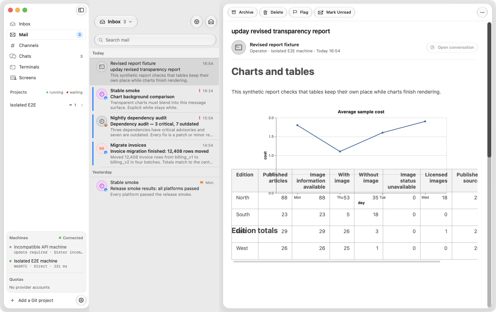
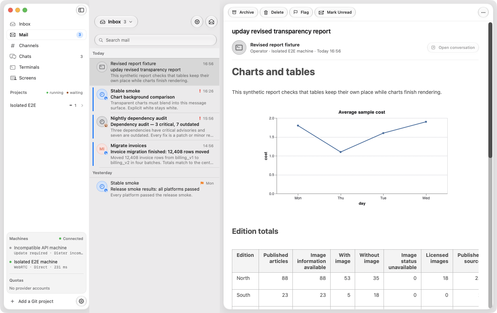

# Mac Mail chart and table placement

The supplied live-Mail screenshot showed a wide table over a chart. This was
reproduced on branch head `3217257f`, including its vector preview and cache
changes, with a synthetic report in the isolated Mac Mail app.

## Cause and fix

Charts begin as short loading placeholders. When an asynchronous render supplies
the final image, TextKit moves the following paragraphs to accommodate its
height. Wide tables are separate native scroll views. Their frames were not
updated by the chart completion path, so they stayed over earlier text and
charts while leaving empty space at their actual positions.

The completion path now reconciles existing wide-table frames against their
settled text anchors whenever a chart changes height or reveals source. This
runs in the same update, preserving the table images and horizontal scroll
positions. It reuses known anchors without scanning or restyling the source.
Documents without wide tables and image replacements of the same height avoid
this work. Stored Markdown, chart vectors and undo history remain unchanged.

## Regression

`completedDiagramsKeepWideTablesAtTheirTextAnchors` puts repeated wide tables
before, between and after two charts. It grows the images from 160 to 440 points
and then shrinks them to 90 points. Before the fix, later table positions were
wrong by up to 560 points; both ordinary and reading-column layouts failed.
After the fix, all table frames match their TextKit anchors within one point,
and horizontal offsets, unrelated paragraph attributes, source and undo state
remain intact. All nine `NativeRenderedCodeBlockTests` passed, including source
fallback, large-report refresh and editable-diagram interaction.

Run the focused regression with:

```sh
mise exec -- just check-changed --dry-run
mise exec -- swift test --package-path apps/apple/mac --no-parallel --filter NativeRenderedCodeBlockTests
```

The local synthetic native fixture and flow are in `tmp/mail-layout/`. They use
the existing `DIETER_TEST_MAIL_REPORT` hook and compositor screenshot mode. The
flow waits for two rendered charts and no fallbacks, scrolls, switches messages,
asserts cached reopening and repeats the journey in dark appearance. These
journey assertions alone passed even before the fix; the geometry regression
above specifically detects the overlap.

| Before                                                 | After                                                    |
| ------------------------------------------------------ | -------------------------------------------------------- |
|  |  |

Screenshots use only synthetic Mail. The supplied screenshot and its report
contents are not committed.

Evidence relative to the worktree:

- `tmp/pipeline/20261027T155344-mac-e2e-acd363/`: baseline compositor captures.
- `tmp/pipeline/20261027T155530-mac-e2e-34b8fc/`: corrected compositor captures;
  the native flow passed in 9.3 seconds. Light/dark scroll captures and cached
  reopening were opened and inspected, with each table below its own heading.
- `tmp/mail-layout/before.log` and `after.log`: native run logs.
- `tmp/mail-layout/regression-before.log` and `regression-after.log`: retained
  failing geometry assertions and the passing focused native Markdown suite.
- `tmp/mail-layout/report.md`, `flows/mac/mail-layout-local.yaml` and
  `native-run.py`: local reproduction inputs and pipeline driver.

`just check-changed` passed the Apple unit/component suites (17 DieterKit,
10 native-helper and 518 Mac cases), the iOS simulator build and documentation
checks. Existing unrelated remote-desktop, production UI and privacy-hardware
opt-in cases were skipped; all required Mail assertions ran. Apple suite reports
are in `tmp/pipeline/20261027T155628-swift-tests-163d69/`. Final formatting and
staged lint passed.

Both native runs used Debug E2E builds and the existing incremental build cache.
The fixture used temporary storage and loopback ports. The pipeline closed its
app and fixture after each run; no task-owned Mac app remained. No production
Mail, operator preferences, installed app or running daemon was changed.
