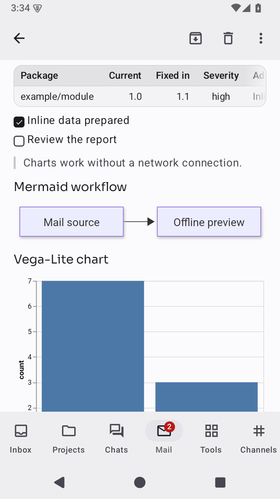
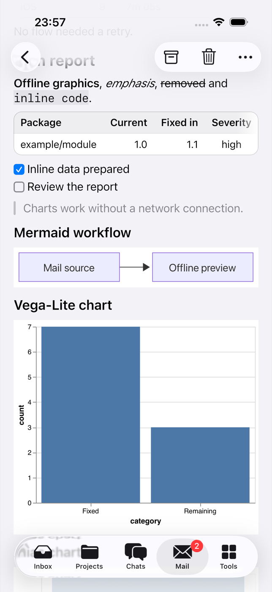
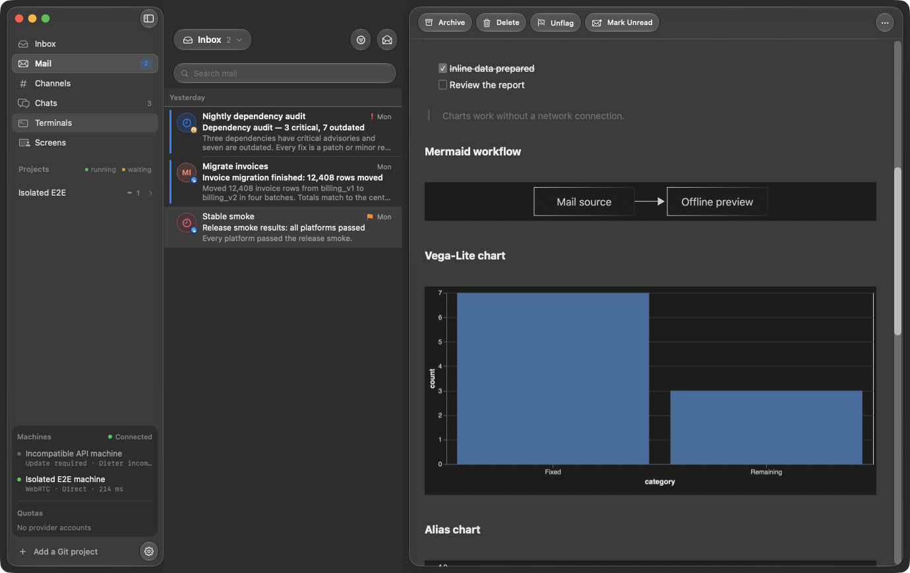

# Rich Markdown in Mail: verification

Verified on 26–27 October 2026 against base `963f6292`.

The Mail readers on macOS, Android and iOS use the same pinned offline
Mermaid/Vega bundle as the Mac Files preview. Native Markdown, links and
tables remain native; supported fences become read-only graphics. Invalid,
unsupported or blocked graphics retain readable source.

## Real readers

The isolated gateway embeds [one report](../../tests/fixtures/mail/rich.md)
for all three readers. It includes Mermaid, Vega-Lite, the `vegalite` alias,
raw Vega, malformed JSON, an external dataset, unsupported fences, raw HTML,
a remote image and workspace links. The flow switches to another message and
reopens the report to check that rendered content belongs to the current body.

The mobile flow checks every graphic, source fallback, the remote image's
alt text, reopening and changing from light to dark appearance. The Mac flow
checks four completed graphics and two source fallbacks, scrolls the report,
switches messages and reopens it. The existing Mail flows cover the ordinary
reader and mailbox actions alongside this report.

| Platform                          | Rich reader flow | Existing Mail flow | Retained evidence directories under `tmp/pipeline/`                        |
| --------------------------------- | ---------------- | ------------------ | -------------------------------------------------------------------------- |
| Android emulator                  | Passed, 66.5 s   | Passed, 48.5 s     | `20261026T143340-android-e2e-d219f3`, `20261026T140933-android-e2e-b5a4ab` |
| iPhone 17 Pro simulator, iOS 26.5 | Passed, 58.6 s   | Passed, 54.6 s     | `20261026T225442-ios-e2e-8bb96a`, `20261026T224532-ios-e2e-4de4b9`         |
| macOS                             | Passed, 8.2 s    | Passed, 12.5 s     | `20261026T230356-mac-e2e-0cf2b8`                                           |

Representative captures from these isolated readers:

| Android                                                                  | iOS                                                              |
| ------------------------------------------------------------------------ | ---------------------------------------------------------------- |
|  |  |

[Android dark appearance capture](assets/mail-rich-android-dark.png).
Both mobile flows assert a completed graphic after changing appearance.



[Mac readable source fallback and blocked external data](assets/mail-rich-mac-fallback.png).

The Mac captures use the desktop compositor for the task-owned E2E window.
The in-process `cacheDisplay` captures leave SwiftUI panes blank on this host;
those captures alone are not visual evidence. Original screenshots, event
logs, accessibility snapshots and results remain under `tmp/pipeline/`.

## Automated checks

The change-selected plan was inspected before verification. Selected Go,
Kotlin, Android, Apple, documentation, workflow and Maestro checks ran once;
failures were rerun only in the affected packages or flows.

| Check                      | Result                                                                                                                                     |
| -------------------------- | ------------------------------------------------------------------------------------------------------------------------------------------ |
| Offline renderer           | 42 Node tests passed; the real bundle renders the shared report in both themes with zero network attempts                                  |
| Shared core and Compose    | JVM tests passed, including fence aliases and exact packaged-asset access; fixture end-to-end tests passed                                 |
| Go                         | Unit/component and end-to-end checks passed; initially failing API, engine and home packages passed on focused rerun                       |
| Apple unit suites          | DieterKit 17, native helpers 10 and Mac 504 tests passed, with count guards                                                                |
| Mac fallback and lifecycle | 10 focused tests passed after the final source-fallback fix, including preservation of successful images, unrelated prose and undo history |
| Android                    | Lint and unit tests passed                                                                                                                 |
| Mac export                 | Shared report exported four static SVGs; existing HTML/PDF rendering and pagination tests passed                                           |
| Pipeline helpers           | 25 tests, 245 assertions passed                                                                                                            |

The iOS Copy Compose resources phase places the bundle under
`compose-resources/composeResources/com.getdieter.mobile.resources`, matching
the pinned Compose resource reader. An absent renderer bundle fails the app
build. Android packages the same generated resources in its shared library.

## Reproduce

Use the repository's pinned tools and isolated workflows:

```sh
mise exec -- just check-changed --dry-run
mise exec -- just check-changed
mise exec -- npm --prefix apps/apple/mac/MarkdownPreview test
mise exec -- just e2e android profile:android-emulator flows:mail-rich,mail
mise exec -- just e2e ios flows:mail-rich,mail
mise exec -- just e2e mac flows:mail-rich,mail
```

The Android profile borrows a running emulator; iOS creates and deletes a
disposable simulator. Mac flows use the separate E2E app. Fixture state and
preferences are isolated, and the workflows verify cleanup.

## Boundaries

Charts accept inline data only. External datasets, image/resource loads,
scripts and chart links remain blocked; raw HTML stays escaped. Mermaid keeps
strict security, and the renderer keeps its source-size and nesting limits.
Vega parameter controls are read-only. Existing Mail body availability and
storage rules remain unchanged; offline graphics do not fetch an uncached body.
